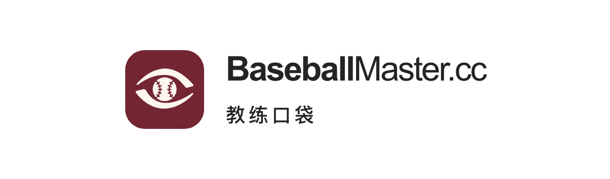

# 教练口袋已确认产品品牌规范

状态：**用户于 2026-10-22 确认，固定沿用。**

确认原话：“教练口袋的产品 LOGO 不错，作为产品规范做保留 和 棒球比赛记录大师 类似。”此前用户已确定中文名：“叫做 教练口袋 吧”。英文产品名保留 **Coach Insights**。

## 固定组合

- 左侧使用已确认的酒红底“洞察之眼＋棒球瞳孔”App 图标，保留完整图形、原有颜色与细节，不另行描摹或替换。
- 右侧第一行固定为 **BaseballMaster.cc**，大小写、英文句点和域名后缀保持；不插入空格。`Baseball` 较粗，`Master.cc` 使用常规字重。
- 第二行固定为 **教练口袋**，适度宽字距，与第一行左对齐。
- 图标在左、两行文字在右，垂直居中；沿用本页确认参考的比例和间距。
- 本次确认参考为首页产品卡中的白底、石墨黑字组合。酒红 `#722F37` 是教练口袋的产品色；原图标同时保留暖象牙白图形。
- **BaseballMaster 母品牌使用用户另行选定的 BM 图形，见 [母品牌标识](PARENT-BRAND.md)。** 本产品组合不替代母品牌 Logo，也不把酒红或比赛记录的深绿设为母品牌色。

## 确认稿参数

下表单位为 CSS px，来自用户确认的本地首页稿；参考 PNG 采用放大渲染，不把像素尺寸直接当作网页字号。

| 项目 | 基准 |
| --- | --- |
| 图标 | 44 × 44，圆角 11 |
| 图文间距 | 12 |
| 主文字 | `BaseballMaster.cc` |
| 英文字体 | Arial，sans-serif 回退 |
| 英文字号／行高／字距 | 19／1.1／−0.855（−0.045em） |
| 字重 | `Baseball: 800`；`Master.cc: 400` |
| 中文 | `教练口袋` |
| 中文字体 | `-apple-system`、BlinkMacSystemFont、PingFang SC、sans-serif |
| 中文字号／字重／行高 | 11／450／1.3 |
| 中文字距／顶部间距 | 0.16em／7 |
| 白底文字色 | `#242426` |
| 产品色 | `#722F37` |

用于手机、页脚和宣传图时可按版位等比例缩放，保持图文结构、两段字重关系、中文名称和图标完整性。不把中文换为“教练洞察”或早期临时名称，不将英文产品名替换域名主文字。需要出现英文产品名时，在组合之外另行注明 Coach Insights。

**同日后续的藏青联动：** 用户指定母品牌和文字使用加深藏青后，本地首页中的产品主文字随全站使用 `#0B1933` 变体，图标、字号、字重及中文名不变；字距按用户后续强调的统一规范归一为 −0.045em（19 px 时为 −0.855 px）。原始 −0.8 px 参考另存 approved-lockup-initial.png。本页最初确认的白底石墨黑参考保留，用于追溯原确认稿。

## 参考与复用

- [确认参考 PNG](references/coach-pocket-2026-10-22/approved-lockup.png)。
- [原始 App 图标副本](references/coach-pocket-2026-10-22/app-icon.png)：复制自 Coach Insights 工程已确认的 1024 px 图标，SHA-256 见机器可读基准。
- [独立 HTML/CSS 源稿](references/coach-pocket-2026-10-22/source/lockup.html)：只含产品组合，不含首页或产品页实现。
- [渲染脚本](references/coach-pocket-2026-10-22/source/render.cjs)。
- [机器可读规范与素材校验值](coach-pocket-baseline.json)。

源稿和图标副本一起保存在本仓库，不依赖被忽略的 output 目录、OS 临时目录或另一个项目的绝对路径。原始来源为 `/Users/JasonChan/Documents/CoachInsights/CoachInsights/Assets.xcassets/AppIcon.appiconset/AppIcon.png`；源工程的图标说明见该项目 `design/app-icon/README.md`，本次不修改 Coach Insights 工程。

这次只归档已确认产品规范并修正本地首页示意图；正式网站、App 界面与发布状态均未因此改变。首页其他视觉和母品牌 Logo 仍按各自的评审与确认处理。
