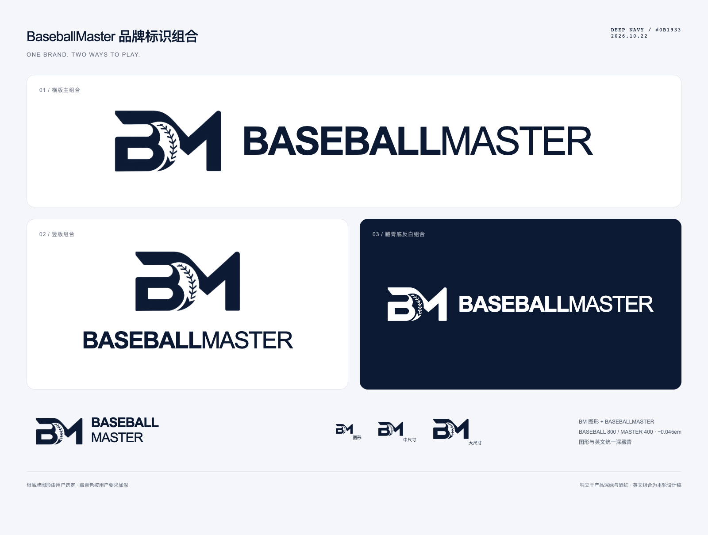

# BaseballMaster 母品牌图形与英文组合

2026-10-22。**BM 图形由用户选定，主色按用户要求加深为藏青 `#0B1933`。** 英文组合为本次本地设计交付，后续修改以用户反馈为准。

用户指定：“品牌 LOGO 用这个。然后 做一套配合上英文的 LOGO 设计。并更新到首页上。”随后要求整体包括文字使用藏青色，并进一步要求“太浅了，再深一点”。

## 图形与颜色

- 采用 BM 连字与棒球缝线负形组成的图形。用户提供的原始图片完整保留，见 [选定原稿](references/baseballmaster-2026-10-22/supplied-original.png)。
- 图形和英文主文字统一使用深藏青 **`#0B1933` / RGB 11、25、51**，不再使用之前的石墨黑，也不沿用第一轮偏浅的藏青。
- 当前提供深藏青透明底组合，以及深藏青背景上的白色反白组合。反白版用于深色底，不把它当作第二套品牌色。
- 母品牌独立于产品色：比赛记录保留深绿，教练口袋保留酒红。

## 英文组合

主文字为 **BASEBALLMASTER**，不插入空格，不带中文产品名。严格继承比赛记录大师既有 [品牌参数](brand-baseline.json)：Arial、`BASEBALL` 字重 800、`MASTER` 字重 400、字距 −0.045em。横版、竖版和紧凑版均使用相同字重与按字号折算的字距；用户强调这是固定规范。

| 参数 | 当前组合稿 |
| --- | --- |
| 英文 | `BASEBALLMASTER` |
| 字体 | Arial，sans-serif 回退 |
| `BASEBALL` / `MASTER` 字重 | 800 / 400 |
| 横版源稿字号 / 字距 | 54 / −2.43（即 −0.045em），单位为 SVG 用户坐标 |
| 图形源稿宽度 / 图文间距 | 148 / 28 |
| 缩放 | 等比例缩放整组图形和英文，保留间距与字重关系 |

组合如下：

- [横版主组合](references/baseballmaster-2026-10-22/baseballmaster-horizontal.svg)：用于桌面首页页头、页脚和横向品牌栏。
- [竖版组合](references/baseballmaster-2026-10-22/baseballmaster-stacked.svg)：用于居中封面和较宽松的宣传版位。
- [紧凑组合](references/baseballmaster-2026-10-22/baseballmaster-compact.svg)：英文分两行，用于狭窄版位。本地首页在 370 px 以下使用此版。
- [独立图形](references/baseballmaster-2026-10-22/baseballmaster-mark.svg)：用于 favicon 或已有完整品牌名称的版位。
- [反白横版](references/baseballmaster-2026-10-22/baseballmaster-horizontal-reverse.svg)：用于深藏青底。

母品牌组合不取代两款产品的 App Icon。产品继续使用各自的图标、`BaseballMaster.cc` 主文字和中文产品名；教练口袋既有组合见 [产品规范](COACH-POCKET.md)。首页全局文字随本轮要求切换为藏青，同步使用产品组合的藏青文字变体，图标和排版结构保持。

## 文件与复现

- [组合总览](references/baseballmaster-2026-10-22/brand-system.png)。
- [原始选定图片](references/baseballmaster-2026-10-22/supplied-original.png)。
- [透明图形准备稿](references/baseballmaster-2026-10-22/transparent-source.png)：内置 ImageGen 完成透明背景准备，原图同时保留。
- [源稿与渲染脚本](references/baseballmaster-2026-10-22/source/render.cjs)，[总览 HTML](references/baseballmaster-2026-10-22/source/brand-board.html)。
- [机器可读参数与素材哈希](baseballmaster-parent-baseline.json)。

SVG 通过透明位图的 alpha 轮廓配合精确藏青填色，英文为可编辑文字；**不是完全描摹的纯矢量图形**。透明 PNG、SVG 与使用说明的本机交付包在 `output/marketing/brand/2026-10-22-dual-product/brand-kit/`，可由上述脚本重新生成。

此次仅更新本地首页设计稿与品牌归档，不改正式网站、App 业务代码或发布状态，不上传部署；教练口袋独立产品页仍未设计。
