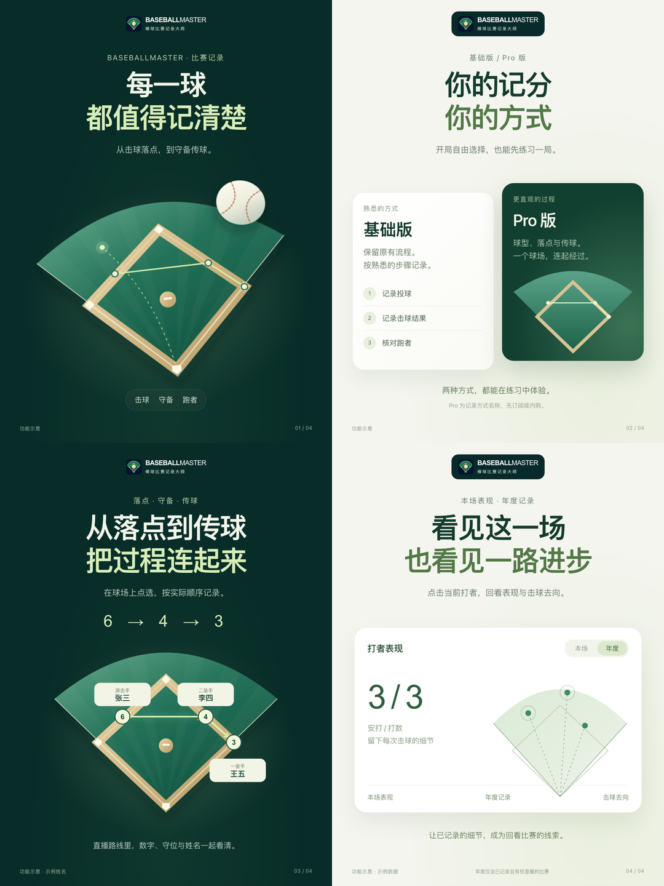

# 宣传图品牌设计规范

状态：**用户于 2026-10-22 确认，作为各种宣传图的默认规范。**

确认原话：“很好，这个设计原则风格规范等，请保留。作为品牌设计规范，for 各种宣传图”。对应作品为 3.1.0 小红书第三版四张品牌海报。本规范与 [Logo 品牌基准](BRAND.md) 一起使用；既有图标、中英文标识和字重组合保持。

## 设计目标与适用范围

以高级消费科技品牌的清晰、克制和精细为目标：大字、充分留白、明确层级和经过设计的产品视觉，让一张图集中表达一个用户收益。

适用于小红书、社交媒体、功能海报、版本宣传、商店宣传图、官网宣传区及其他宣发物料。按渠道调整尺寸、内容和构图；不因此改动 App 界面或现有官网导航样式。常规宣传制作直接沿用本规范；明确的新设计要求以用户当次指令为准。

## 视觉语言

- **深绿与米白双主题。** 深色表达品牌、球场和过程；浅色表达选择、数据与回看。系列可交替形成节奏，不要求每张都使用两种底色。
- **标题是第一层。** 默认居中、两行、简短，一行提出主题，一行强调收益。大字标题不使用标点符号，以换行组织语义，避免句末标点干扰视觉居中；小字号说明按正常语法使用标点。不堆功能名。
- **主视觉是第二层。** 每张只有一个视觉焦点，可使用精细球场、棒球、路线、卡片或图表，将功能组织成清楚的画面。
- **细节有节制。** 允许渐变、细边框、柔和投影和轻微透视，形成层次。图形边缘、曲线、光影方向及卡片间距要统一，草纹等细节必须裁在正确轮廓内。
- **文案是第三层。** 一句引导加一句必要说明即可；用具体动作与收益表达功能。页脚只放必要的示意说明、统计范围或页码。
- **留白有秩序。** 品牌、标题、说明、主视觉和页脚各有独立空间。相邻元素不拥挤，重要内容不贴边。

## 色彩与字体参数

以下是 1080 × 1440 参考画布的参数。其他尺寸按比例调整，并按最终观看大小重新检查。

| 用途 | 已确认参数 |
| --- | --- |
| 品牌标识底色 | `#092a2a` |
| 海报深色底 | `#082d28`，可叠加低强度绿色径向渐变 |
| 海报浅色底 | `#f4f5ef`，可叠加低强度浅绿渐变 |
| 浅底正文主色 | `#143b2d` |
| 深底标题强调色 | `#d7edb7` |
| 浅底标题强调色 | `#537947` |
| 品牌中文副标题 | `#c6d5cc` |
| 中文字体 | 系统字体栈，优先 PingFang SC |
| 标题 | 参考 91 px／600 字重／1.18 行高／−3.7 px 字距 |
| 引导说明 | 参考 27 px／1.7 行高 |
| 眉题 | 参考 24 px，适度字距 |
| 页脚 | 参考 16 px，保持实际输出可读 |
| 安全边距 | 参考左右 64 px，其他元素可按构图扩大 |
| 卡片 | 参考 38–40 px 圆角、细边框与柔和阴影 |

保留 BASEBALL 粗体、MASTER 常规字重，英文不插空格，中文副标题沿用既有字距。海报默认顶部居中展示品牌组合；浅底时使用深绿承托板，保留白色英文与浅灰绿中文。其他比例可按构图调整位置，不拆散或变形品牌组合。

## 宣传画面与实际界面的关系

宣传视觉可以重新组织功能。可以使用原创矢量图、立体感球场、路线图、概念卡片和数据图，不要求把完整手机截图作为主体。实际截图适合承担细节证据，可按目的选用局部或完整画面。

重绘的功能画面须标“功能示意”；使用示例姓名或数据时须相应标注。真实截图不改写球员、比分、按钮或路线来冒充产品能力。示意图同样依据已实现功能：守备顺序正确、姓名与守位对应、统计范围准确，不把示例表现描述为真实用户成绩。

## 内容与渠道

- 一组宣传图按“核心收益 → 选择方式 → 关键过程 → 回看价值”等叙事组织，按实际主题取舍。四张是这次参考作品的数量，不是永久规定；遵循用户当次数量要求，不用重复页面凑数。
- 文案短、自然、少修饰，默认不加 emoji。Pro 是记录方式名称，无订阅或内购，不能用付费升级的视觉暗示表达。
- 小红书延续用户确认的做法：默认不放版本号、预告／审核状态、站外网址、下载提示、联系方式或二维码。其他渠道按目标与用户要求决定是否需要版本或行动入口，不把小红书限制机械套用到所有物料。
- 宣传稿的发布语境与真实状态分别核对；不根据一张海报反推 App 已发布、审核通过或服务已部署。

## 已确认的四种构图

| 参考图 | 画面组织 | 主要用途 |
| --- | --- | --- |
| [01 每一球都有迹可循](references/promotional-2026-10-22/images/01-每一球都有迹可循.png) | 深绿、大标题、带轻微透视的球场与棒球 | 品牌封面、核心价值 |
| [02 两种方式一种顺手](references/promotional-2026-10-22/images/02-两种方式一种顺手.png) | 米白、错落双卡片、基础版／Pro 版 | 功能选择、方式对比 |
| [03 从落点到传球](references/promotional-2026-10-22/images/03-从落点到传球.png) | 深绿、清楚的路线、数字与姓名卡片 | 流程、守备、直播 |
| [04 看见本场也看见进步](references/promotional-2026-10-22/images/04-看见本场也看见进步.png) | 米白、单张大卡片、统计与击球图 | 表现、年度、回看 |

这四张是风格参考。新主题应根据内容重新组织图形，不逐字复用旧标题或把同一球场套到所有功能上。

## 交付与复核

交付单张原图、简短文案及便于取用的 ZIP；总览用于查看，不作为单张发布图。保留可编辑源稿与生成方式。小红书默认 3:4，本次为 1080 × 1440；其他平台按实际版位制作。

导出后逐张查看成图，检查标题无标点、断行与视觉居中、文案层级、图形裁切、遮挡、姓名与路线、示意标识及页脚可读性。核对尺寸、图片加载、透明通道和文件完整性；主题、品牌组合和色彩与本参考保持一致。

## 持久保存与复现

- 已确认成图与总览保存在本规范旁的 [参考目录](references/promotional-2026-10-22/)，纳入 Git；不依赖被忽略的 output 目录。
- [机器可读规范](promotional-design-baseline.json) 保存确认日期、原话、色彩、文字与构图参数，以及参考素材 SHA-256。
- [可复用渲染源稿](references/promotional-2026-10-22/source/render.cjs) 保存本次 HTML/CSS/SVG 构图。用 Node 运行，依赖 Playwright 与 sharp；可通过 `CODEX_ARTIFACT_NODE_MODULES` 指定包目录。
- 渲染默认输出至 `output/marketing/brand/reference-2026-10-22/`，支持 `BASEBALLMASTER_POSTER_OUTPUT` 指定其他输出位置，不覆盖已确认参考图。
- 新物料按渠道、版本和日期保存在 output/marketing 对应目录；风格变更经用户明确确认后再更新本规范与基准。
