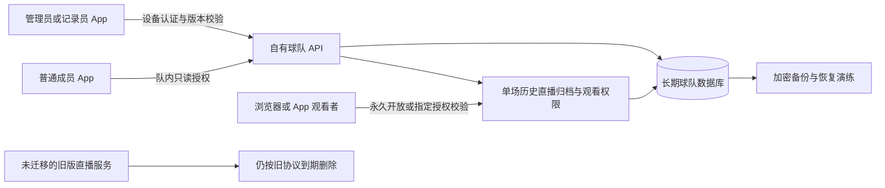

# BaseballMaster 3.0 球队协作规划与 TODO

更新日期：2026-10-13。状态：**App 3.0 功能、发布验证、网站／服务部署和最终签名归档完成，待用户上传审核。** 当前分支 `codex/dev-3.0`，工程 3.0（Build 1），仍沿用唯一目录 `/Users/JasonChan/Documents/BaseballMaster`。实际结果与限制见 [发布交接](../releases/3.0/REVIEW-HANDOFF.md) 和 [逐项验收](../releases/3.0/ACCEPTANCE.md)。没有推送／合并或 App Store 提交。D03 套餐核对、R02 真实 30 天增长为运行期观察项，不算已完成测量。

3.0 的目标是让同一支球队在不同设备上持续积累比赛档案：多个记录员可以分别记录比赛，普通成员通过邀请查看球队历史和统计，用户无需注册账号。球队身份、授权、同步、存储和恢复由 BaseballMaster 自己的服务控制，**不使用 iCloud／CloudKit，不要求 Apple 账号或其他第三方账号登录**。

先看根目录 [3.0 发布功能计划](<3.0 发布功能计划.md>)，集中查看本版功能、当前状态和发布事项。本文件保留详细方案、原编号开发 TODO 与验收标准，不另复制一套技术任务编号。入口：[用户已确认的要求](#confirmed-requirements) · [比赛时间补填与更正](#match-date-correction) · [权限](#permissions) · [同步与交接](#sync) · [历史直播开放](#historical-live-access) · [服务器与容量评估](#capacity-assessment) · [开发 TODO](#development-todo) · [验收矩阵](#acceptance) · [发布条件](#release-gates)。此前 2.3 交付按 [2.3 发布计划](<2.3 发布功能计划.md>) 保留；小组件留在 [后续待办](BACKLOG.md)，版本未定。

## 随手补充区

后续新增想法先写在这里，评估后再归入范围和任务。不以新增想法自动扩大 3.0 首版。

- 2026-10-10：比赛开始时可选择今天之前的时间，已结束比赛可修改比赛时间；已纳入[首版范围与流程](#match-date-correction)、T01–T03 和 A42–A46；本机部分已实现，共享联动待完成。
- 2026-10-11：阵容确认时的选人菜单同时显示姓名与背号，便于辨认；已纳入[显示优化](#lineup-player-numbers)、L01 和 A47；候选显示已实现，完整联合验收继续按矩阵完成。
- 2026-10-11：用户反馈练习球场裁切、换投容易选错。新增 L02／L03、A48／A49；按“选择 → 核对姓名与背号 → 确认后保存”实现，取消不污染统计，验证记录见开发进度。
- 2026-10-11：用户进一步明确 L03 的局数指赛事登板额度：确认登板后即使未投球也占一局，与统计 IP 无关。同一投手同一局不重复计；开赛前候选与尚在进攻方的阵容选择不等于实际登板。局数提醒按这一口径修正，原 IP 测试不能替代此项验收。

## 用户已确认的要求

| 事项 | 已确认内容 |
| --- | --- |
| 版本 | 原先讨论为 2.4 的球队同步与协作升级，正式规划为 3.0 |
| 后续 Android | 2026-10-13 用户明确 Android 客户端、真实跨平台验证、APK 分发与更新暂缓，后续版本待定；取代此前 3.1 安排 |
| iPad 与 iPhone Duo | 2026-10-09 确认不纳入 3.0，先完成本版既定内容；大屏与折叠屏适配保留为后续待办，版本未定 |
| iPhone 开发与验收设备 | 2026-10-11 用户确认：所有后续开发以 iPhone 16 及更新机型的正常界面为准，不做旧机型小屏或极窄视口的专门适配与检查 |
| 多记录员 | 同一个队伍可以有不同记录员，跨设备共享球队信息与比赛档案 |
| 非记录员查看 | 球员、教练、家长等普通成员也能查看球队历史比赛 |
| 查看范围 | 默认队内可见，通过邀请加入；需要时分享单场比赛 |
| 历史直播开放 | 管理员或记录员可为历史直播选择永久开放、仅指定人员可看或不开放；关闭观看仍保留数据，不因终场或关闭自动删除 |
| 使用门槛 | 不要求用户注册账号，不引入手机号、邮箱和密码注册流程 |
| 服务控制 | 不采用 iCloud 方案；球队服务、数据和权限由项目自行控制 |
| 域名与服务器 | 继续使用 `baseballmaster.cc` 及其所属的现有服务器；评估响应速度、单场空间与每队每月 20 场的容量 |
| 前期规划阶段 | 2026-10-08 完成规划与 TODO，只做文档，不开发、不切分支或工作区；后续启动顺序见下一条 |
| 启动顺序 | 2026-10-09 用户要求开始 3.0：先交付关键页面截图与使用流程 PDF，大致确认后进行实际功能开发；本条更新此前仅规划阶段的安排 |
| 页面评审结果 | 共享从「球队」进入、纯本机模式、固定三角色、四栏导航、双向记分交接、指定观看授权、普通语言状态提示和设备配对均已确认；记录员查看全队内容；未安装者引导下载 iOS App |
| 直播与历史的边界 | 用户补充确认：实时直播链接沿用现有开播／关闭、到期和持链接观看方式，终场后有效期内仍可匿名看；原链接关闭或到期后，查看留存档案使用独立历史入口和三种开放权限；队内成员在 App 查看历史不受网页开放设置影响 |
| 比赛时间补填与更正 | 2026-10-10：比赛开始时允许设置今天之前的日期与时间，用于补填；已经结束的比赛也可修改比赛时间，用于纠错或补填 |
| 阵容确认选人显示背号 | 2026-10-11：在双方阵容确认页面选择球员时，候选菜单同时显示姓名与背号，方便辨认；以用户提供的现有页面截图为问题依据 |
| 当前阶段 | 2026-10-10 仅评估；2026-10-11 用户明确「现在开始 3.0 的开发」，已进入正式实现与验证，取代此前等待开发的安排 |

以下角色细则、邀请有效期、存储结构和实施顺序是据此制定的首版设计基线；有数值的运营参数均标为规划默认值，实施时可根据验证调整。它们不是已上线功能或服务承诺。

### 页面与流程评审

2026-10-09 用户已确认主要流程，并指出 v1 记分页改动过大。[页面与使用流程提案 v2](../design/3.0/README.md) 已撤下重绘的比分栏、球场与按钮，改用现有 2.3 App 原始截图说明保留边界；球场比例、比分、投打信息和记分按钮布局沿用现状。共享比赛仅增加简短同步状态与二级「同步与交接」入口，纯本机记分页保持原样；具体状态入口位置继续按现有页面做最小改动。v2 共 18 张页面、12 页 PDF，另补 iOS 下载引导，并明确记录员查看全队内容与实时直播／终场回看的权限边界。配对短语和不使用 iCloud／Apple 账号的方式已确认。已确认项目不重复请求确认；D01 的细化不代表功能已实现或已验收。

## 与 3.1 及后续 Android 的版本分工

2026-10-13 用户明确 Android 客户端、真实跨平台验证、APK 分发与更新暂缓，移出 3.1，后续版本待定；原方案见 [Android 暂缓规划](ANDROID-APK.md)。[3.1](3.1-BATTED-BALL.md) 正式安排击球记录改版，功能尚未开发。基础比赛、历史统计、球队协作和直播观看已在 iOS 3.0 中实现或继承；原 Android 清单中的对应任务指 Android 端实现，不代表 3.0 未完成。

3.0 权限定稿先覆盖以下边界，沿用下文角色矩阵逐项评审，不将当前草案视为已通过验收：

- 管理员、记录员与普通成员分别可以查看、创建、修改、导出和删除哪些资料。
- 谁可以邀请、调整角色、移除成员或设备，以及最后管理员、换设备和管理权恢复的处理。
- 多记录员分别记录不同比赛，以及同场唯一写入、正常交接、强制接管和离线补传的规则。
- 队内查看权限与单场历史观看授权的区别，三种开放方式的切换、逐人撤销及离队影响。

身份与数据协议从 3.0 起适用于多个客户端：稳定 ID、角色、权限判断、修订、幂等、错误码与版本协商不依赖 Apple 账号或 iOS 存储格式。Keychain 是 iOS 的凭证保存方式，不是服务端身份定义；Android 以后使用对应的安全存储实现。权限以服务端当前授权为准，客户端平台或版本号不能授予权限。

设计与验证分别归入 D01、D02、D05、V01 和 V03；3.0 使用平台无关的接口样例与基准数据验证协议。现有成果可供后续 Android 复用，客户端实现及真实跨平台验证继续暂缓，具体方案保留在 Android 单份规划中。

## 产品定位与首版范围

3.0 将球队档案的维护从单台设备扩展到整个球队。完成标准是一条可持续使用的流程：创建共享球队 → 邀请成员 → 不同记录员记录比赛 → 队内查看历史与统计 → 换设备或换负责人后继续使用。

| 纳入 3.0 首版 | 行为边界 |
| --- | --- |
| 共享球队 | 支持新建，也支持把已有本机球队及选定比赛加入共享；本机模式继续可用 |
| 三种角色 | 管理员、记录员、普通成员；无需逐项勾选权限 |
| 免注册身份 | 系统自动生成成员和设备凭证，通过邀请或已有设备授权加入 |
| 年度规则 | 2026-10-12 用户确认：不主动创建或划分赛季；按比赛实际日期的自然年归类，1 月至 12 月，补填／更正跨年后自动移动 |
| 同步内容 | 球队资料、名单、按日期推导的年度视图、赛程、比赛完整记录、正式统计及修订来源 |
| 多记录员 | 不同场比赛可同时记录；同一场正式比赛同一时间只接受一台设备写入 |
| 记分交接 | 正常移交、管理员强制接管、失联设备重新联网后的冲突处理 |
| 私有队内查看 | 首版在 App 内查看；已授权设备可缓存，展示最后同步状态 |
| 历史直播与单场分享 | 单场记录长期保存；可选永久开放、仅指定人员或不开放；网页免注册，不授予队伍成员资格 |
| 权限恢复 | 新设备授权、设备撤销、管理员补位、管理恢复码及管理权转交 |
| 历史导入 | 按球队与球员对应关系预览导入，重复及冲突由管理员确认 |
| 比赛时间补填与更正 | 开赛前可选择过去的日期与时间；已结束比赛可更正比赛时间；纯本机与共享比赛均支持，计时独立 |
| 阵容确认选人显示背号 | 双方选人候选项显示姓名与已有背号，沿用现有布局、候选范围和选人规则 |
| 服务可靠性 | 长期存储、服务端备份、恢复演练、删除规则、运行监测与容量限制 |

首版不包含同时协同编辑同一场比赛、球队公开搜索或公开主页、聊天、报名收费、联盟赛事管理、跨球队合并官方比赛、自动球员实名认领、Android 记分端或完整的队内网页门户。网页首版只承担邀请落地和单场查看。小组件继续保留原待办，不因版本调整进入 3.0。

2026-10-09 用户确认：iPad 原生大屏适配与 iPhone Duo 折叠屏适配均不纳入 3.0，也不作为本版发布条件。3.0 继续完成既定的球队协作、身份权限、同步与历史直播开放内容；设备适配另见 [后续待办](BACKLOG.md#adaptive-device-support)，不自动归入 3.1。

2026-10-11 用户进一步确认：所有后续 iPhone 界面开发与验收按 iPhone 16 及更新机型进行，不追加旧机型小屏或极窄浏览器视口的适配任务与发布门槛。既有验证证据保留，历史“小屏”命名不代表后续要求；不因本条修改 iOS 最低部署版本。

保留普通棒球、教练投手和成人慢垒现有能力；3.0 不改变它们的判定口径。纯本机用户不必开启共享，也不必连接服务器才能继续记分。

## 比赛时间补填与赛后更正

2026-10-10 用户新增的两项优化纳入 3.0。这里的「比赛时间」是比赛实际发生的日期与开赛时刻，精确到分钟，包含今天之前的日期；不等同于录入时间、最后修改时间或比赛时长。以下为实施基线，覆盖纯本机／共享比赛、本队／观赛记录，以及三种现有记分模式。

**评估结论：可行，属于中等改动。** 页面入口改动较小，主要工作在统一日期口径、与计时解耦，以及同步、旧档和报告的联动回归；不需要改变记分规则。此前已完成评估；2026-10-11 开始实现，本机能力已接入，共享相关联动继续按 T01–T03 完成。

### 使用流程

| 场景 | 操作与结果 |
| --- | --- |
| 正常开赛 | 新建比赛 → 现有赛前设置中的「比赛时间」默认「现在」 → 按原流程开始；未手动指定时沿用实际 Play Ball 时刻 |
| 补填旧比赛 | 新建比赛 →「比赛时间」选择实际日期和时刻，例如昨天 14:00 → 确认阵容并开始补录；Play Ball、重启及交接均保留已选时间，不改成今天 |
| 已结束比赛纠错 | 历史比赛 → 比赛详情的更多操作 →「修改比赛时间」→ 显示原值并选择正确日期与时刻 → 保存；保留终场状态，返回后显示新时间 |
| 安排未来比赛 | 继续使用「安排未来比赛」和原有赛程流程；不通过补填直接开始未来比赛，已结束比赛的时间不能设置为未来 |

入口放在现有赛前设置和历史详情中，不重排记分页面，也不增加注册或开启共享的前置要求。取消编辑不改数据；保存失败保留输入并说明原因。日期与时间一同编辑，允许跨月、跨年补填，不限制为当天。历史列表按比赛实际时间倒序排列；更正后移到对应位置，不因刚刚修改就排到最前。

### 时间、权限与联动边界

- **比赛时间与计时分开。** 现有 `StoredGame.startedAt` 会在首次 `startGameClock` 时写入，历史列表目前按 `updatedAt` 排序，部分报告与海报的日期取值顺序也不同。因此不能只放开日期选择器。拟增加可选的比赛实际时间字段（如 `playedAt`），统一已开赛／终场记录的日期取值：明确设置的比赛时间 → 旧 `startedAt` → 旧 `scheduledAt` → `createdAt`；未来赛程仍按 `scheduledAt` 显示。旧档缺少字段时兼容读取，不伪造当时未知的时间。
- **补录不造成超时。** 计时开始、暂停、累计时长与时间赛提醒使用独立计时数据；不能用今天减去补填日期来计算已经比赛了多久。赛后改日期不重新开赛、不重放逐球操作、不改变比分、阵容、投打数据或已有时长，也不整体平移逐球日志时间。`createdAt`、实际操作／结束时间和审计时间不倒填；`updatedAt` 仍记录本次真实修改时刻，服务端修订与同步先后不按比赛时间判断。
- **沿用比赛编辑权限。** 纯本机比赛可直接修改。共享比赛由管理员或负责／正式接手该场的记录员更正，沿用记分权和版本校验；管理员编辑也要取得写入权。普通成员及仅获网页观看授权者只读，记录员可查看全队内容不等于可修改其他人负责的比赛。
- **所有日期入口一致。** 更正后更新历史排序、按日期筛选、最近若干场统计取样、球员比赛记录、PDF／TXT、海报及已授权历史网页。未按日期筛选的累计成绩不变；比赛 ID、原始来源标签和球员映射不变；跨年更正自动调整年度列表、统计与导出范围，不新增比赛。已导出的静态文件需重新生成，不能远程修改旧副本。
- **作为正式修订同步。** 共享比赛保存旧值、新值、操作者与实际修改时刻，刷新对应统计／网页投影和缓存。离线修改按现有待同步规则展示；重新联网后验证权限及基础版本，冲突保留为待核对内容，不覆盖别人较新的更正。修改比赛时间不改变实时开播状态、历史开放模式、邀请有效期或已授权人员。
- **日期显示稳定。** 新设置的时间同时保留比赛时区，跨设备按比赛时区显示同一日期和时刻；旧档无时区信息时使用兼容回退并允许用户更正，不推断未知赛地。备份、恢复与导入保留明确设置的比赛时间和时区。

对应 T01–T03、A42–A46。D01 后续页面细化补充上述两个入口；当前 v2 截图／PDF 尚未呈现这两项，不视为新增流程已完成视觉验收。

## 阵容确认选人显示背号

2026-10-11 用户根据「双方阵容」截图提出：选人菜单不能只显示姓名，也要带上背号。**评估为较小的显示改动**：现有 `Player` 已有 `numberTexts`／`numbersText`，阵容行已经显示背号；`SetupAndRosterViews.swift` 中双方阵容的替换候选按钮目前使用 `replacement.name`，可复用已有背号资料，无需新增数据字段或云端接口。2026-10-11 已开始实现，沿用现有阵容布局。

- 候选项拟显示为「姓名 · #背号」，例如「陈明 · #12」（示例）；主客双方、本队记录与观赛记录的阵容确认入口保持一致。赛程再次进入阵容确认时同样适用。
- 多背号沿用现有显示规则，例如「陈明 · #12 / #18」；保留 `0` 与 `00` 的区别。旧资料没有背号时显示「姓名 · 暂无背号」，不补成 `#0`；无姓名资料沿用现有回退，不重复拼接同一个背号。
- 选择仍绑定球员 ID，同名或同背号不合并；候选排序、已入选人员排除、棒次和守位规则不变。只补充选人文字，不重排阵容或记分页；长姓名和多背号需检查可读性及辅助功能朗读。

对应 L01、A47，覆盖三种现有比赛模式、纯本机与共享资料。v2 PDF 保留为此前设计材料，新增实际界面截图及验证见开发进度。

2026-10-12 投球文案补充：四个投球按钮从左到右显示「坏球｜好球 - 看｜好球 - 挥空｜界外」。正式比赛、练习、历史纠错选项、App 文字记录、TXT／逐打席 PDF 导出与直播／历史观看网页统一沿用。按用户最新确认，仅 3.0 新产生的投球记录使用新文案；旧比赛和旧版 App 上传的记录保留原文，不做显示转换或历史迁移。网页直接显示上传内容，本项无需单独部署网页或修改服务端；三振出局等结果描述、记录动作、统计口径和历史数据编码保持兼容。

## 球队与球员身份

### 同一球队的判定

服务器为共享球队生成不可变的 `cloudTeamID`。名称、简称、城市和图标只是资料；改名不改变球队身份，同名不自动合并。可展示便于核对的球队编号，但编号和 UUID 都不是访问凭证。

App 提供“创建球队”“加入已有球队”，已有球队增加“开启球队共享”。开启前展示上传范围，由创建者选择名单与历史比赛；其他本机球队、未选中比赛、个人设置和练习内容不上传。

新设备通过邀请加入后使用同一份云端名单。系统确认的是同一份球队档案，现实中的队伍归属由队内邀请关系确认；不因名称或 Logo 宣称完成官方认证。

### 球员与旧资料对应

共享球员使用球队内稳定的 `cloudPlayerID`；改名、换背号、退出名单不改变历史统计归属。同名、同背号不能作为自动合并依据。首版不建立跨球队的全局球员身份。

保留本机 `Team.id`／`Player.id` 与云端 ID 的映射，逐场处理历史中的球员引用、初始阵容和统计归属。历史比赛保留当时的名单快照；更新现役名单不会自动重写旧比赛。名单中的退队人员可归档，不能因删除现役名单而抹掉历史。

历史导入先预览：选择球队和比赛 → 对应球员及年度 → 标记重复与冲突 → 管理员确认 → 分批幂等上传。导入前保留本机备份；取消和网络中断不损坏原资料。

不同设备中的同一现实比赛可能具有不同本地 UUID。日期、对手、比分只用于提示疑似重复；管理员决定保留、跳过或作为独立比赛。相同来源 ID 的不同内容也必须进入核对，不能按文件名、时间或相似比分直接覆盖。

## 免注册身份与邀请

### 自动建立的身份

第一次使用共享功能时，App 自动建立随机设备身份和凭证，不使用硬件指纹、广告标识或通讯录识别人。服务器通过凭证验证设备，再查询设备在具体球队中的成员关系与角色。昵称只用于展示，不证明真实身份。

同一成员可以关联多台设备，每台设备有独立凭证；同一设备也可以加入多个球队，在每个球队拥有不同角色。管理员只能处理自己球队的成员关系，不能借此撤销另一球队的授权。设备自身的失效和球队内的移除分开处理。

凭证使用系统安全随机源生成，规划至少 256 位随机强度，服务端只保存适合验证的摘要。App 使用本机 Keychain 保存，关闭同步属性并采用仅本机可用的保护方式；**这不接入 iCloud Keychain**。凭证不进入比赛 JSON、普通备份、日志、分析事件、观赛 URL 或二维码。协议与存储实现列入 I01／I02 验证。

### 加入与换设备

管理员选择“邀请记录员”或“邀请成员”，分享二维码或链接。接收者核对球队与角色，填写称呼后确认加入，之后自动保持授权。管理员的授予在已加入的成员列表中单独完成，不生成可以直接获得管理员角色的通用邀请。

首版默认每个邀请只能成功兑换一次，24 小时后失效；兑换须原子完成，可撤销。邀请在可信群聊或当面传递；持链接的人在兑换前可以转发，因此不能把邀请等同于实名验证。已兑换后管理员可以核对称呼并移除误入设备，重新邀请正确对象。需要邀请多人时生成多份邀请，不使用永久全队密码。

没有安装 App 时，扫码打开邀请网页，明确展示「前往 App Store 下载」与「已安装，打开 App」入口，沿用官网现有 iOS App Store 下载地址。安装后回到原链接或重新扫码继续，不承诺安装过程自动保留邀请；邀请过期时联系邀请人重发，不能仅安装 App 就自动加入。链接本身必须包含足够随机的秘密，普通球队编号只能定位球队，不能用来加入。

新手机已有旧设备可用时，由新设备出示配对请求，旧设备确认球队、成员和新设备后授权。配对默认 10 分钟有效、单次使用，只授予选定球队的关联，不直接复制旧设备秘密，也不自动授予其所有球队权限。旧设备不可用时由管理员重新邀请。

服务端对设备建立、邀请兑换、恢复尝试和未知编号查询实施限流；错误不泄露未授权球队的名称、名单、成员数量或比赛情况。

## 权限与球队生命周期

### 固定角色矩阵

“负责比赛”指被分配为该场记录员；实际写入还必须持有当前设备的记分权。管理员编辑正在进行的比赛也需要先接管，不能绕过同步规则。

用户确认记录员可以查看全队内容，球队业务资料与比赛的查看范围和管理员一致，不限于自己创建、负责或接手的场次。查看范围不等于管理权限：成员／角色／设备管理、恢复码和其他管理操作仍按下表控制，设备凭证等秘密不作为可查看的球队资料。负责场次限制仅用于写入或管理相应比赛，不用于限制记录员阅读全队档案。

| 操作 | 管理员 | 记录员 | 普通成员 |
| --- | --- | --- | --- |
| 查看球队资料、赛程、历史比赛和统计 | 可以 | 可以 | 可以 |
| 查看队内已同步的进行中比赛 | 可以 | 可以 | 可以，只读 |
| 创建和安排比赛 | 可以 | 可以，默认负责自己创建的比赛 | 不可以 |
| 编辑赛程、记分与赛后更正 | 可分配或接管后编辑 | 只编辑自己负责或正式接手的比赛 | 不可以 |
| 设置补填时间、修改已结束比赛时间 | 可分配或接管后编辑 | 只编辑自己负责或正式接手的比赛 | 不可以 |
| 新增、修改正式球员姓名和背号 | 可以 | 可以；本场阵容调整不反写正式名单 | 不可以 |
| 修改球队资料、停用／恢复球员、关联历史球员 | 可以 | 不可以 | 不可以 |
| 邀请成员、调整角色、移除其他成员或设备 | 可以 | 不可以 | 不可以 |
| 配对、查看及移除自己的关联设备 | 可以；最后管理设备不可直接移除 | 可以，仅本人在所选球队的身份 | 可以，仅本人在所选球队的身份 |
| 正常移交记分 | 可以移交自己持有的比赛 | 可以移交自己持有的比赛 | 不可以 |
| 强制接管失联记分设备 | 可以，目标必须是有效记录员或管理员 | 不可以自行抢占 | 不可以 |
| 设置历史直播开放模式、管理指定观看者 | 全队比赛 | 自己负责的比赛 | 不可以；永久开放的链接可转发，指定人员须另行授权 |
| 导出可见比赛的 PDF／TXT | 可以 | 可以 | 可以；导出文件不携带写入权 |
| 导出球队完整档案、导入历史、删除云端正式比赛 | 可以 | 不可以；可删除未发布的个人草稿 | 不可以 |
| 管理恢复码、管理权转交、解散共享球队 | 可以，单独确认 | 不可以 | 不可以 |

共享名单修改与本场阵容调整分开。本场临时球员使用稳定比赛内 ID，管理员合并到正式球员前标为“未关联球员”，不凭姓名归并到个人年度统计。关联后按明确修订重算，保留当时比赛显示资料。

每个 API 都按当前球队、成员、设备、对象和操作检查权限，包含分页、统计、导出、修订读取及附件路径。不可凭请求传入的角色字段或一个难猜 ID 放行。角色下降或成员撤销与在途提交在服务端事务中确定先后：撤销提交之后到达的写入不能再成功。

每队最多两名有效管理员，按成员身份计算，同一管理员配对多台设备不重复占名额。现有管理员可在「成员管理」把一位记录员或成员设为第二名管理员；已有两名时，先把一名调整为其他角色，再设置新管理员。服务端在同一事务中校验上限，并发操作也不能超过两名；最后一名管理员仍不能直接降级或退出。创建球队和管理恢复都只产生一名有效管理员。

### 退出与删除

退出球队不删除球队档案；卸载 App 不解散球队；在本机移除缓存不等于云端删除。普通成员只能退出自己，或配对／移除自己的关联设备；管理员可以移除成员或全队单台关联设备。设备列表对非管理员只显示本人设备，移除仅影响所选球队。唯一管理员必须先转交管理权或明确选择解散，不能直接退出并留下无人管理的球队。

删除云端正式比赛仅管理员可做，需展示对全队历史、统计与分享链接的影响；删除标记参加同步，旧设备不能将其重新上传复活。规划回收站为 30 天；恢复也产生新修订，不降低云端版本号。解散球队立即停止成员访问、邀请、记分和分享，进入同样明确的删除流程。解散前的管理员可经专用管理入口验证身份后恢复球队；恢复须重新授权成员，已关闭的邀请与公开链接不复活。

成员被移除后停止后续读取和写入；设备下次联网获知后清理下载缓存、停止同步。已缓存离线资料、此前导出及截图无法保证远程追回。个人原有本机资料不因解除共享被误删，未同步的原创记录保留为隔离草稿，不能借此继续访问云端或自动发布。

## 管理权恢复

| 情况 | 首版处理 |
| --- | --- |
| 旧设备还在 | 通过一次性配对授权新设备，可随后移除旧设备 |
| 设备丢失，但还有其他管理员 | 其他管理员撤销丢失设备，邀请新设备并设置相应角色 |
| 所有管理设备均不可用 | 使用创建共享球队时保存的管理恢复码 |
| 所有管理设备和恢复码均丢失 | 无法仅凭队名、昵称、截图或相似历史证明管理权，不提供据此取回球队的后门 |

创建球队时生成高强度管理恢复码，提供可保存的恢复卡，要求明确确认已保存或明确选择稍后保存并持续显示提醒。恢复码至少 128 位随机强度，服务端保存摘要；完整值不进入日志、普通球队导出或常规备份。管理员可以主动重新生成，旧码立即失效。移除管理员设备、管理员退出、移除或降级管理员时，旧恢复码也必须立即失效；剩余管理员重新生成并保存新卡，防止已撤销人员凭旧卡取回管理权。

恢复码是应急管理钥匙，不用于邀请。兑换成功后原子撤销旧设备的该球队访问、未用邀请和配对请求，将所有历史直播设为不开放并撤销指定观看授权，生成新恢复码；保留比赛及历史直播档案，旧成员关系待新管理员重新授权。明确提示这些后果，恢复和轮换过程进入审计记录。响应丢失时只能由同一次恢复请求绑定的新设备续取结果，不能再次消费恢复码创建第二个管理员。

日常人员更替优先使用管理员邀请和转交，不必动用恢复码。所有管理员具有同等管理权；至少保留一名有效管理员，可指定备用管理员。

## 同步与记分交接

### 正式数据和本地草稿

云端维护球队正式版本，本地保留已同步副本及尚未同步的修改。保存成功后才进入发送队列；网络失败不撤销本机已经保存的记分。服务器确认接收后，App 才显示“已同步”。

共享操作使用独立的 `serverRevision`、基础版本 `baseRevision`、幂等操作 ID 和记分权代次 `writerEpoch`。现有直播的本地 `revision` 不直接充当跨设备云端版本。服务器在一个事务内校验权限、基础版本、当前记分设备和代次，再提交比赛、统计投影、变更游标及审计记录。

相同操作 ID、相同内容的重试返回已有结果；相同 ID 不同内容拒绝。版本冲突保留双方内容并提示处理，不能用本机时间或最后到达顺序覆盖。撤销、重做和历史更正均发布新的正式修订，不把版本号倒退。

完整比赛记录及同修订的统计投影一起提交，并带规则／统计格式版本。服务端校验必填数据、引用和统计不变量；球队汇总只使用每个正式比赛 ID 的最新有效修订，不把各手机现成的年度总数相加。统计未完成或格式不兼容时显示待更新，不能把缺失数据冒充零值。三种模式采用同一批基准比赛核对 App、服务端汇总、网页和导出结果。

### 同一场只由一台设备记分

每场共享比赛记录负责成员、当前设备和 `writerEpoch`。同一个人的两台手机也必须交接；其他设备只读或保留独立待处理草稿。记分权不会仅因心跳超时自动交给别人，离线记录员仍可继续本地记录。

| 情况 | 处理规则 |
| --- | --- |
| 两名记录员记录不同比赛 | 分别持有各场记分权，可同时写入 |
| 正常移交 | 原设备暂停录入并上传全部待同步修改；新设备拉取并验证最新正式版本；服务器原子变更设备与代次，新设备确认后继续 |
| 移交请求或响应丢失 | 使用同一操作 ID 查询权属，界面显示交接处理中；任何设备不能依据旧缓存假定自己仍有写入权 |
| 原设备断网或损坏 | 管理员明确确认风险后强制接管；云端提升代次，新设备从最后已同步版本开始 |
| 被接管的旧设备重新联网 | 旧代次写入拒绝，未同步修改保留为冲突草稿，不自动覆盖新版本 |
| 处理冲突草稿 | 管理员比较两份记录，可在当前正式版本中补录确认内容，或明确舍弃；原草稿保留到处理完成 |
| 完赛后修改 | 负责记录员或接管后的管理员获得该场写入权，以新修订更正；其他成员只读 |
| 写入者被降级或移除 | 立即停止新的服务端提交并解除有效记分权，等待管理员重新分配；不把权利自动转给任意在线设备 |

完全断网的新比赛可先作为个人本地草稿记录，恢复网络后在有权的球队中发布并检查重复。首次加入球队、取得已有比赛记分权、交接和强制接管均需要服务器确认；不承诺多设备完全断网时可以协调同一场正式比赛。

### 同步展示和失败恢复

界面至少区分“仅本机”“待同步”“同步中”“已同步至某时刻”“需要处理冲突”“权限已失效”“需要更新 App”。记录设备未同步时，其他设备显示最后确认状态和时间，不能伪装成实时数据。

增量同步以服务器游标读取变化和删除标记；游标过期时重新取得一致快照。分批下载中断可续传，先完整落盘再切换正式副本，不显示半份名单或比赛。重复、乱序响应、服务重启和后台挂起都不能重复创建比赛或丢掉待发送队列。

同步触发以 App 前台、重新联网、主动刷新和本地成功保存为基础。后台刷新只能作为优化，不承诺锁屏后持续实时上传；首版不依赖推送才能取得最终一致状态。

## 队内查看与历史直播开放

队内入口包括球队概览、未来／进行中／历史比赛、单场详情和球员统计。普通成员进入后直接查看，没有记分和编辑入口；服务端同时拒绝越权请求。多球队切换须明确当前球队，列表、缓存和导出都受该球队身份约束。

### 保存与开放分别管理

3.0 历史直播记录进入自有持久存储，保留比分、逐球内容、历史垒况、当场阵容及 Box Score 等可供回看的内容。终场、关闭观看、移除观看者和切换开放方式只改变访问权限，不删除归档，也不影响原比赛和统计。真正删除仍是管理员单独执行的删除操作，适用回收站与备份清除规则。

管理员可管理全队比赛；记录员管理自己负责或接手的比赛。两者在历史比赛详情中选择下列三种模式，修改保留审计记录并由服务端校验权限。

| 开放模式 | 谁能通过历史直播页观看 | 数据处理 |
| --- | --- | --- |
| 永久开放 | 拿到该单场链接的人，无需注册或安装 App | 不设自动到期时间，持续保留；管理员或负责记录员可以随时收紧或关闭 |
| 仅指定人员 | 管理员或负责记录员选中并授权的成员／受邀观看者 | 持续保留；逐人授予或撤销，普通转发链接不带来访问权 |
| 不开放 | 历史直播观看入口关闭；管理人员可在有权的 App 管理入口维护档案 | 持续保留，以后可以重新选择开放方式，不因关闭而删除 |

用户已确认：“不开放”控制终场后的历史直播网页入口，不改变已加入球队的普通成员在 App 内查看球队比赛与统计的权限。记录员也能查看全队历史，不限于自己负责的比赛。

用户于 2026-10-11 再次明确：实时直播只要打开链接就可以观看，原链接内容不再提供后，才按历史观看授权查看留存内容。终场不是立即拦截直播链接的时点。原链接在终场后一小时内仍匿名可看；主动关闭或进行中一小时无同步／心跳后失效。历史采用独立入口，指定人员或不开放设置不会提前拦截仍有效的实时链接。旧链接过期不自动重定向或升级为永久回看，即使永久开放也通过独立历史链接访问。关闭／到期均不删除球队长期档案。未迁移的 2.x 会话仍按旧协议兼容处理。

历史直播默认不开放；进行中的临时开播不会自动升级为永久开放。已结束比赛可明确选择历史模式；未选择则历史入口不开放并保留数据，原直播链接继续自己的有效期。此前规划的“分享默认 7 天到期”由本次三种模式替代；永久开放不因七天、终场后一个小时或记录设备离线而失效。

### 指定观看者的免注册授权

管理员或负责记录员可以选择已有球队成员，也可以单独邀请队外观看者。已有成员使用已授权身份；队外观看者只获得这一场的只读资格，不成为球队成员，不获得记分或其他比赛的查看权限。

队外流程为：打开单次邀请 → 填写称呼并发起申请 → 邀请方核对后确认 → 绑定当前浏览器或 App 设备。服务器保存单场观看授权与独立设备会话，网页使用受保护的会话凭证，每次读取都验证当前模式和授权状态。邀请仅用于建立授权，不是可反复转发的长期观看密码；未经确认的新浏览器不能凭复制链接观看。

这仍是凭受信任的邀请确认设备，昵称不构成实名验证。更换浏览器、清除会话或换设备后重新授权；无需手机号、邮箱、密码或第三方账号。单人撤销只影响该观看者，全部关闭则停止所有观看会话。以球队成员身份获得的观看授权在离队时同步撤销；若要继续作为队外观看者，须明确重新邀请。

### 模式切换与页面保护

开放设置使用独立访问版本，不改变记分权。永久开放改成指定人员时，原匿名链接不能绕过授权；改成不开放时，网页、数据 API、附件和预览接口都停止提供该场内容，已打开页面下一次联网也须重新检查。重新开放由有权限者主动执行，不因再次同步、恢复本地备份或服务器重启而自动发生。

正常记分交接不会丢失归档或观看设置，接手记录员可继续管理。永久开放时，创建者离队不会自动关闭球队已公开的页面；离队者和其他持链接者一样可看，管理员可收紧。指定观看则以实时有效的授权为准。管理恢复、比赛删除或球队解散统一关闭历史观看、撤销指定授权；恢复比赛也不会自行恢复公开状态。

开放前预览该场会展示的队名、当场球员显示资料、比分、逐球记录和 Box Score。共享球队 ID、完整名单库、替补资料库、其他比赛、管理记录和秘密不得从页面或 API 泄漏。更正比赛后展示最新正式修订的观看投影并标注更新时间，不开放内部修订历史。

观看页不被搜索引擎收录，不缓存私有响应、不记录完整链接秘密、不向第三方脚本或外部跳转泄漏凭证。指定人员或不开放模式下，未授权请求和社交预览只显示通用提示；永久开放时也只展示确认过的公开信息。切换模式无法收回此前截图、导出或外部平台缓存，不能承诺远程抹除这些副本。

## 自有服务与现有工程衔接

### 当前基础

2026-10-08 的本地代码基础如下，均为现状核查，不代表 3.0 已实现。

| 现有内容 | 3.0 所需变化 |
| --- | --- |
| [Team、Player、StoredGame](../../BaseballMaster/Models.swift) 已有本机 UUID 和比赛状态 | 增加云端身份映射、共享来源、权限与版本元数据，保留旧档兼容 |
| [CoreDataRosterStore](../../BaseballMaster/PersistenceController.swift) 保存本机 SQLite | 增加持久发送队列、正式副本与冲突草稿；按对象同步，不上传整份个人数据库 |
| [GameStore](../../BaseballMaster/GameStore.swift) 以本机快照恢复备份 | 恢复后重新核验云端绑定；旧备份不能覆盖全队或带回已撤销的权限 |
| [LiveBroadcast](../../BaseballMaster/LiveBroadcast.swift) 已有安全随机凭证、Keychain、修订重试 | 可复用经过验证的设计经验；直播发布凭证不提升成球队管理凭证 |
| [直播协议](../../live/PROTOCOL.md) 和 [运维说明](../../live/README.md) 只保存短期展示数据 | 3.0 新增持久历史直播归档、三种开放模式及指定观看授权，长期档案纳入备份 |

现有 2.x 直播数据库位于临时内存存储，按原协议过期删除且不备份。3.0 的历史直播归档使用新的持久存储，纳入正式备份，不沿用这套自动删除规则。两套存储与协议分开，仍走 2.x 且未迁移的会话继续按旧协议处理；当前页面评审阶段不改线上行为。

3.0 新直播及明确迁入的历史直播在上传前说明长期保存范围，先确认持久归档成功，再展示“已保存”。仅本机、不使用直播或共享的比赛仍不自动上传。已从旧服务器删除的内容不能直接找回；若本机还保有完整比赛，可由有权限者选择重新生成历史直播档案，默认不开放。旧链接不因导入自动恢复为公开页面，也不在后台将旧临时库整体复制成长存数据。

### 首版架构基线

域名和主服务部署位置已由用户确定：**沿用 `baseballmaster.cc` 及现有服务器**，在同域下划分球队 API 与历史观看入口，保留现有官网和直播路径。规划采用自有 HTTPS API、独立的关系数据库和单场只读网页；应用服务沿用项目已有 Node.js 技术体系，长期数据库优先采用 PostgreSQL，以事务处理成员权限、版本竞争、幂等操作和交接。具体受支持版本、资源配额和部署配置在 D03／R01 验证后固定，不在本轮安装或采购。

球队档案服务与旧直播服务分开数据库、系统服务身份、目录、权限和备份。现有服务器作为首版部署基线，容量或并发达到升级条件时再评估扩容，不自动更换域名或购买服务器。生产、测试的数据库和秘密分开；默认只通过 HTTPS 代理访问，不公开数据库端口。备份仍须放在项目可控且独立于主机故障域的位置，不把同盘副本当成灾难备份。

设计对象至少包括：`Team`、`Member`、`Device`、`MemberDevice`、`Invite`、`PairingRequest`、`Player`、`Game`、`GameRevision`、`WriterAssignment`、`ReplayArchive`、`ReplayAccessPolicy`、`ViewerGrant`、`ViewerSession`、`ShareLink`、`RecoveryCredential`、`AuditEvent`、`DeletionMarker` 和 `SyncCursor`。归档保存状态、开放模式、指定名单和会话分别建模；归档引用正式比赛修订，开放设置有独立版本。访问某个对象必须校验其所属球队及有效访问途径；客户端不能自行指定云端角色、正式修订或记分权代次。

接口分为设备认证、球队与成员、邀请／配对／恢复、名单／年度、赛程／比赛／修订、交接、同步变化、统计、历史直播归档、开放模式和指定观看授权。所有变更接口定义幂等规则与冲突错误；对象 ID、凭证、基础版本和球队范围必须清楚分离。D02 输出可验证的协议约定后再开始实现。

3.0 历史直播展示必须来自已授权且正式接收的比赛修订。长期保存和自动同步不触发公开观看；开放设置单独管理。未迁移的旧客户端会话继续由旧服务处理，3.0 新建和迁入的历史档案进入持久服务；不把旧直播发布凭证直接提升为球队管理权。

### 格式与备份兼容

为云端协议、比赛数据格式和统计格式分别标注版本。不支持新字段语义的旧客户端只读或提示更新，不能丢掉字段再回写；最低客户端版本由服务端能力协商决定，不能靠升级本地版本号强行覆盖。

旧 App 继续使用原本机与直播流程，不自动获得云端写权限。3.0 本机备份不携带设备秘密、恢复码或有效邀请；导入后云端绑定处于待核验状态，重新授权和比较版本后才能同步。备份中的旧删除状态、旧角色和旧修订均不能推翻当前服务端状态。

导出球队完整档案包含可迁移的比赛、名单、关联和格式说明，由管理员操作；不携带可恢复访问权的秘密。原始来源、临时球员、观赛身份、年度、规则和未知统计标记都保留，不因共享改成另一种比赛口径。

## 域名 服务器与容量评估

**2026-10-13 发布补充：** 现已完成完整 App 样本同步、并发、索引／压缩备份和独立恢复测量，见 [实际容量记录](../releases/3.0/CAPACITY.md)。以下 2026-10-08 的内容保留为当时结构评估，不再作为“尚未部署”的当前状态。

2026-10-08（北京时间）完成只读基础检查和数据结构测算。结论：**现有服务器适合作为 3.0 首版部署基线，当前 CPU、内存和磁盘都有余量；小请求响应可接受，大文件传输有明显波动，仍须核对公网带宽并验证实际同步方案。** 以下区分当前测量、结构外推和容量预算，不作为已经通过的 3.0 性能验收。

### 服务器早期只读资源评估（历史记录）

通过已有 SSH 管理入口只读检查；未读取生产比赛正文或凭证，未创建直播、重启服务、调整配置或进行压力测试。

| 指标 | 采样结果 |
| --- | --- |
| CPU | 4 核；1 秒采样忙碌约 0.75%，1／5／15 分钟负载约 0.02／0.01／0.00 |
| 内存 | 总计约 16.36 GB，可用约 15.06 GB；不是云厂商套餐标称值 |
| 磁盘 | 文件系统总计约 236.16 GB，已用约 17.75 GB，剩余约 218.41 GB |
| 现有直播服务 | 运行中，当前进程组内存约 24.31 MB；2 GiB 为服务上限，不是当前占用 |
| 数据位置 | 当前直播仍在 tmpfs 临时存储；3.0 长期档案必须写入独立持久磁盘数据库 |

这里只代表采样时刻的空闲程度，不能推出高峰并发上限。磁盘剩余空间还需给现有业务、系统、数据库事务日志、迁移和故障处理留余量。

### 速度测量与限制

| 路径与样本 | 结果 | 可以说明什么 |
| --- | --- | --- |
| 服务器本机读取健康接口，10 次 | 全部 200，约 0.53–0.76 毫秒 | 当前小接口服务处理快；不含真实比赛读写与公网 |
| 当前电脑按源站 IP 访问域名 HTTPS 健康接口，5 次 | 全部 200；4 次 0.17–0.29 秒，1 次 1.21 秒；中位约 0.263 秒 | 当前路线的小请求可用，有长尾波动 |
| 同样路线下载现有 563,960 字节官网图片，3 次 | 全部 200；0.74／2.17／6.73 秒 | 约 564 KB 的完整传输也会波动，不能用小接口耗时替代同步速度 |
| 当前电脑默认网络路径访问健康接口，5 次 | 中位约 0.632 秒，范围 0.332–1.226 秒 | 本机代理／路由对结果有影响，须与源站定向样本区分 |

公网样本为顺序、低频、只读 GET，每次 curl 使用新连接并完成 TLS 校验。源站定向样本显式绕过 curl 代理配置，但仍可能受到本机透明代理和网络路由影响；没有测到全国不同运营商、移动网络、高峰并发或 3.0 尚未实现的数据库接口。不能将图片下载结果直接当成服务器购买的带宽上限。

现有直播每 10 秒轮询、无变化返回小响应，有利于当前体验。3.0 应继续按变化拉取：名单／比赛列表分页，单场详情按需下载，进行中比赛增量提交，历史比赛不反复全量轮询；压缩传输后再衡量真实延迟。不能每记录一球都上传全队历史或一份数 MB 的完整比赛。

作为带宽敏感性示例，250 人每 10 秒都下载 100 KB 的完整投影，需要约 20 Mbps 的平均出站数据量；若每次仅 10 KB，则约 2 Mbps，均未计协议开销。实际无变化响应更小，不能把这个假设当成现有直播实测流量。**公网带宽套餐、月流量限制和峰值观看人数目前未核定**，列入 D03；本轮未在生产做并发压测。

### 单场比赛和每月 20 场的空间

存储测算以当前完整比赛格式为基础，包含阵容、比分、逐球、统计、纠错命令和直播阅读投影。实际读取的本机模拟器与升级样本均为短流程记录，不能充当完整比赛的实测均值。测算按 250／400／600 次记录操作、55／80／110 个打席扩展现有序列化字段，使用不同 ID；这些是结构容量模型，不是经记分引擎重放验收的整场比赛。

当前升级样本中，一条纠错命令约 2,865 字节，一条逐球事件约 1,145 字节，一条文字日志约 159 字节。现有纠错版本还保存上一份完整命令历史，因此多次赛后更正会明显增加空间。下表按十进制计算，**1 MB = 1,000,000 字节，1 GB = 1,000 MB**。

| 存储口径 | 每场估算 | 每队每月 20 场 | 每队每年 240 场 |
| --- | --- | --- | --- |
| 仅历史直播阅读投影 | 约 0.06–0.14 MB | 约 1.2–2.8 MB | 约 14.4–33.6 MB |
| 完整比赛加阅读投影，不含额外纠错版本 | 约 1.10–2.61 MB | 约 22–52 MB | 约 0.26–0.63 GB |
| 完整比赛加阅读投影，保留 3 次完整纠错历史 | 约 3.21–7.64 MB | 约 64–153 MB | 约 0.77–1.83 GB |
| 保留 10 次完整纠错历史的较重场景 | 约 8.13–19.37 MB | 约 163–387 MB | 约 1.95–4.65 GB |
| 首版主库容量预算，按常规 0–3 次更正并留出元数据／索引余量 | **5–10 MB** | **100–200 MB** | **1.2–2.4 GB** |

这些数据未包括照片、视频、长期保存的 PDF／海报、数据库事务日志、临时空间和备份。5–10 MB 是常规场次的规划预算，不是最大场次限制；大量更正、延长赛或大阵容可超过该范围。实际 PostgreSQL 表、索引与压缩后的落盘量需在 3.0 验证。

结构模型 gzip 后约为原始大小的一小部分，例如 400 次操作、无额外更正的完整比赛加阅读投影从约 1.75 MB 变为约 0.099 MB。但样本含重复阵容与固定文字，可能比复杂实际比赛更易压缩；这只是压缩潜力，不能当作生产实际压缩率或以此承诺容量。

### 增长 版本和备份预算

按每场 5–10 MB 的主库预算，10 支队伍一年约 12–24 GB；100 支队伍一年约 120–240 GB，尚未加备份和运行余量。现有约 218 GB 空闲磁盘足以开始小规模使用，但不适合承诺 100 队长期无需扩容，更不能将剩余空间全部分配给比赛。

正式修订必须可追溯，但不能在每次同步后独立永久复制整场全量 JSON。400 次操作若每次保留一份逐渐增大的全量副本，即使最终约 1.75 MB，累计也可能约 350 MB／场；20 场约 7 GB，远高于上述预算。采用最新完整状态、可追溯的增量操作、必要检查点及去重的更正历史；不能通过静默丢掉必要纠错历史来满足预算。完整同步数据也可能超过旧直播 API 的 2 MiB 上限，新接口须单独设计容量、分批传输和校验。

备份费用与主库另算。额外一份完整副本大致再占一份数据空间，但“保留 30 天”不等于只保留一份；每天独立保存完整库，未压缩时最多接近 30 份当期数据。D03／R02 需验证支持每日恢复点的增量、去重或压缩方案，分别核算主库、备份、事务日志及独立故障域存储。当前没有把备份预算假定为固定两倍，也没有因此采购或启用任何新服务。

评估证据：本机 [采样文件目录](../../output/validation/3.0/server-capacity-2026-10-08)，包含 `server-metrics.json`、`https-probes.json`、`direct-https-probes.json`、`static-transfer-probes.json`、`game-samples.json`、`storage-model.json` 和 `capacity-calculations.json`。证据只保存指标、样本位置与计算口径，未复制生产直播数据。

## 长期保存与运行责任

开启共享前说明上传内容、队内可见范围、单场分享、设备撤销的离线限制和云端删除方式；本机模式不默认上传。隐私与支持已按实际实现更新并部署；商店申报依据已提供，由用户在 Connect 核对提交。

以下为首版运行目标，必须经过演练与容量评估才能作为上线配置；不作无限存储或零数据丢失承诺。

| 项目 | 规划默认值或要求 |
| --- | --- |
| 长期档案 | 保留到管理员删除或球队解散；若未来收费或调整限额，须提前告知并提供导出，不静默清理历史 |
| 历史直播 | 永久开放、指定人员和不开放三种模式均长期保存；终场或关闭不删除；永久开放没有自动到期时间，可主动收紧 |
| 删除回收站 | 30 天；过期从活动数据清除，旧设备不能复活 |
| 备份 | 至少每日加密备份，备份最长保留 30 天；放在项目可控且独立于主机故障域的存储，密钥分开保管 |
| 最终清除 | 按上述回收站和备份周期，旧内容最长可能在删除后 60 天内从全部保留副本到期清除，需在政策中准确说明 |
| 恢复目标 | 首版目标 RPO 不超过 24 小时、RTO 不超过 24 小时；即灾难时最多可能损失最近一天尚未备份的云端修改，目标一天内恢复，须实测验证 |
| 恢复演练 | 上线前完整演练；之后规划每季度演练，本文不创建定时任务 |
| 容量 | 为球队数、成员／设备、比赛大小、修订、请求和备份定义配额与告警；超限明确拒绝或提示，不能截断比赛后声称同步成功 |
| 日志 | 保留必要操作归属、对象、结果和时间；不记录凭证、恢复码或完整比赛正文，运维日志与队内审计分别授权 |

删除和权限撤销记录须能在恢复时继续执行。灾难恢复应先核对并重放最新删除／撤销记录，再开放服务；无法确认其新旧时默认关闭相关访问、撤销旧秘密并重新授权，不能因恢复旧备份复活分享链接、已移除成员或已删除比赛。无法证明应删除的范围时保持恢复环境隔离，不能把缺少删除记录的旧库直接上线。

灾难恢复另生成新的服务恢复代次，客户端必须重新核对云端快照、操作确认记录和本地副本。对于落在备份缺口内、曾被服务器确认的本机记录，保留为待核对资料，通过受权恢复流程补入；不能自动重复执行邀请、删除或记分操作，也不能把较旧云端副本静默覆盖到完整的本机历史。服务恢复代次与正常比赛修订、记分权代次分别管理。

审计记录至少覆盖邀请与加入、角色调整、设备移除、记分交接／强制接管、正式比赛修订、历史导入、删除与恢复、公开分享和恢复码操作。比赛显示称呼及来源设备帮助核对，但不将设备凭证持有者宣称为经过实名验证的自然人。

## 开发 TODO

**3.0 App 功能、网站／服务部署与发布交付已完成（2026-10-13），Apple 上传／审核由用户执行。** 62 项保留原编号；D03 的套餐核对、R02 的真实 30 天运行观察明确保留为运行期工作，不冒充已实测。其余任务按 [发布验证](../releases/3.0/ACCEPTANCE.md) 的设备／环境范围收尾。原页面提案为过程资料，记分页保持原布局；击球与落点改版已于 10 月 13 日确认纳入 3.1，尚未开发。

### 当前实施进度（2026-10-13）

| 范围 | 实际结果与证据 |
| --- | --- |
| D／I | 固定三角色、邀请、设备配对与撤销、管理恢复、90 天认证轮换、审计分页和权限负向验证完成；协议 1 和生产 HTTPS 已运行 |
| C／S | 名单与完整比赛同步、年度归类、正式统计、单场写入权、双方交接、草稿核对、游标重建、删除／解散恢复完成 |
| U | 实时直播继续有效链接匿名看；历史永久开放／指定人员／不开放独立控制；关闭保留档案，恢复不复活旧链接 |
| T／L | 时间补填／更正、日期时区与年度联动、选人背号、练习球场、各路径换投确认及登板额度完成 |
| M | 历史导入、本机恢复后核对、完整球队档案导出／校验／独立只读导入、旧语义写回保护完成 |
| V | 最新共 275 个唯一 App 单元／集成方法，既有 11 个关键原生流程及本次名单权限流程通过；协作服务最新 77 项、旧直播 17 项通过。49 场景及权限补充的证据与限制见 ACCEPTANCE |
| R | 协作服务、邀请／配对／历史页和官网已部署；每日独立 COS 加密备份、撤销日志、恢复演练、系统监测、最终签名归档和审核材料完成；未上传 Apple |

生产验证使用 App 生成的完整三模式合成比赛；20 场正文和网页约 16.8 MB，30 并发读取 P95 约 1.48 秒。测量、样本边界和备份预算见 [容量记录](../releases/3.0/CAPACITY.md)，替代仅靠早期结构估算判断已完成的做法。

### D 方案与协议定稿

依赖：以现有规划初稿为输入，优先完成 D01 权限与 D02 协议定稿；实施按用户授权推进。

- [x] **D01** 优先定稿队伍角色矩阵、邀请／撤销／恢复、记分权与历史观看授权，逐项明确允许和拒绝的行为；冻结首版页面流程、离线边界和管理恢复文案，制作可评审交互稿，确认参数调整不会削弱队内私有默认值。
- [x] **D02** 定义平台无关的对象关系、身份映射、接口／错误、幂等、服务端修订、记分代次、服务恢复代次、变化游标、删除标记和格式兼容协议；历史直播归档、开放模式、指定授权与会话分开建模；协议不绑定 Apple 身份或 iOS 存储，明确供后续 Android 接入的兼容边界。
- [ ] **D03** 【服务与完整样本测量完成；套餐带宽／计费待运行期核对】在 `baseballmaster.cc` 及现有服务器上核定技术栈、受支持版本、公网带宽／流量套餐、峰值并发、独立持久数据库与备份位置，记录容量／成本及隔离方案；已有只读硬件、网络小样本和每月 20 场结构测算，仍须验证实际同步、压缩、版本去重、索引和备份增量后的空间与性能。
- [x] **D04** 固定邀请／配对及观看会话参数、回收站、备份和审计保留参数，定义恢复目标与限额；永久开放不设自动到期时间，关闭不删除；将参数变化同步到产品文案和验收。
- [x] **D05** 准备三种比赛模式、旧备份、重复导入、同名球员、跨球队和冲突修订的基准数据，确定预期比分／统计／导出结果；提供平台无关的协议样例、权限允许／拒绝及格式兼容预期，供 3.0 验证及后续版本复用。

### I 身份与权限

依赖：D01–D04；对应 A01–A10、A27–A29、A36。

- [x] **I01** 实现无注册的随机设备认证及本机凭证保存，确认不启用 iCloud／CloudKit／同步钥匙串，不以昵称或设备 UUID 代替秘密认证。
- [x] **I02** 实现服务端凭证摘要、轮换、请求鉴权与限流，覆盖撤销后旧凭证、日志脱敏和认证错误不泄露球队资料。
- [x] **I03** 实现球队内成员与多设备关联、三角色矩阵和统一对象级授权，覆盖读取、统计、导出、修订及跨球队访问；记录员可查看全队业务资料，不因不是负责记录员而拒绝读取，管理能力另按矩阵限制。
- [x] **I04** 实现带角色、短期、单次、可撤销邀请及安装落地流程；未安装时提示 iOS App Store 下载，安装后从原邀请继续；并发兑换最多一个成功，失效链接不能加入。
- [x] **I05** 实现旧设备授权新设备的一次性配对、成员设备列表及单设备移除，不复制凭证或默认开放所有球队。
- [x] **I06** 实现管理员授予／转交、成员降级／移除／退出及最后管理员保护，处理与在途提交的竞态。
- [x] **I07** 实现管理恢复卡、恢复码轮换与应急恢复，原子撤销旧授权／邀请／公开链接，覆盖响应丢失后的恢复续接。
- [x] **I08** 实现队内操作审计、称呼与设备来源显示及管理员查询范围，防止把审计接口变成跨球队资料入口。

### C 球队档案与数据模型

依赖：D02、D05、I01–I03；对应 A01、A07、A11–A14、A24–A28。

- [x] **C01** 实现新建共享球队和本机球队开启共享的范围预览，保持不共享用户原有离线流程。
- [x] **C02** 实现云端球队／球员／比赛与本机 ID 映射、名单归档和多球队隔离，同名数据不自动合并。
- [x] **C03** 实现球队资料、正式名单持续同步与停用／恢复；管理员与记录员均可新增、修改球员；球队资料和停用／恢复由管理员处理，普通成员只读（2026-10-13 更新）。按比赛日期自动生成年度视图，不建立赛季对象或分季入口；赛程沿用完整比赛同步，本场阵容不反写正式名单。2026-10-12 本地实现与验证，生产部署另验。
- [x] **C04** 扩展本机存储保存云端绑定、正式副本、发送队列、删除标记及冲突草稿，旧数据迁移失败可恢复原文件。
- [x] **C05** 实现完整比赛和同修订统计投影的原子保存、格式校验及版本记录，三种模式和历史未知值完整保留。
- [x] **C06** 实现仅按正式比赛最新修订汇总的球队／球员统计，覆盖临时球员后续关联、观赛排除和不重复计数。2026-10-12 本地功能与 App／服务端验证完成，生产及完整验收另列。
- [x] **C07** 实现本地移除、退出、名单归档、云端比赛删除／恢复及球队解散的独立语义和回收站，联动统计与链接关闭。

2026-10-12 名单／年度补充：共享名单保存云端球员 ID 与不可变 `sourceID`，各设备将同一来源 UUID 用作本地球员引用，不按名字或背号合并。新设备的球队本地投影使用云端球队 ID；历史比赛按 `sharedTeamID` 归入共享队，保留原本机球队 ID、当场名单与全部逐球引用。原本机球队继续独立使用，不因云端改名／停用而被重写。2026-10-12 历史批量导入已接入独立副本与逐场来源映射；管理员可在导入时明确对应正式球员，关联随比赛同步并用于年度统计／报告，比赛快照及事件引用保持不变。2026-10-12 继续完成临时球员的单场对应、改选／解除及修改记录；年度统计、个人逐场与 PDF 仅采用最后收到的正式比赛。C06 本地完成，原当场快照与文字不改写，详见 [球员对应开发记录](../releases/3.0/DEVELOPMENT.md#player-links)。C02 的发布前全矩阵仍随 V 项验收。

年度范围由 `StoredGame.displayDate` 和保存的比赛时区推导。新比赛保存时区；本机旧档首次升级固定当时设备时区，未知时区的旧共享包使用 UTC 回退。旧 `seasonID`／备份中的 `seasons` 仅保留来源兼容，不作为分组条件。年度不创建、不编辑、不单独同步；随比赛最新修订自动重算，安排／进行中只显示在列表，不计入完赛成绩。个人旧独立记录没有比赛时区，仍按本机日历归年；它们不进入共享球队总成绩。

### S 同步与记分权

依赖：I03、I06、C04–C05；对应 A08、A13–A23、A27–A28。

S02 游标压缩／全量重建、S08 管理员集中核对和 S09 正式统计联动均已完成，原稿不会自动合并。具体结果见发布验证与开发记录。

- [x] **S01** 实现本机先保存再入队、增量与压缩传输、幂等提交、确认后标记已同步及失败重试；不逐球同步全队历史或永久复制全量版本，杀进程和响应丢失不丢操作。

- [x] **S02** 实现按对象与球队的增量游标、分页快照和删除传播，游标过期全量重建时保留个人待同步草稿。
- [x] **S03** 实现基础版本校验和事务内授权，拒绝陈旧修订、同操作 ID 不同内容和乱序覆盖。
- [x] **S04** 实现每场唯一当前写入设备、负责成员和记分权代次；不同场可并行，同成员第二台设备也须交接。
- [x] **S05** 实现同步完成后的正常交接、新设备取数核验、原子切换和异常续接，交接期间不出现两台正式写入者。
- [x] **S06** 实现管理员强制接管、风险提示及旧代次阻断，不因单纯断网或心跳超时自动抢占。
- [x] **S07** 实现离线创建本地比赛、连续记分及恢复联网后发布；共享比赛首次取权和交接明确要求联网。
- [x] **S08** 实现冲突草稿比较、管理员补录／舍弃与处理记录，旧设备未同步内容不能静默丢弃或覆盖正式版本。
- [x] **S09** 接入撤销重做、历史更正、终场后更正和统计／报告更新，每次形成新正式修订并保持同版本输出。
- [x] **S10** 实现同步状态、最后确认时间、权限失效／版本不支持提示和前台刷新，验证后台挂起后的补拉；记分页保持现有比分、球场、投打及按钮布局，只补充简短共享状态与二级交接入口，不挤压球场或遮挡现有控件。

### U 查看与历史直播开放

依赖：I03–I06、C03、C06、S01–S04；对应 A11–A12、A22–A26、A29–A31、A37–A41。

- [x] **U01** 实现共享／本机球队标识和多球队切换，普通成员默认进入只读球队页，所有页面保留清晰导航。
- [x] **U02** 实现未来／进行中／历史比赛列表、单场详情及最后同步状态，缓存与未同步状态不冒充实时。
- [x] **U03** 实现球队／球员统计筛选及 PDF／TXT 导出，跨设备口径一致，不导出权限秘密。
- [x] **U04** 实现终场后单场回看预览、永久开放／仅指定人员／不开放三种设置及访问版本校验；记录员仅管理负责比赛，关闭保留归档。实时直播继续沿用原链接有效期与匿名观看，包括终场后一小时；历史权限不得反向限制有效直播链接。
- [x] **U05** 实现无需安装 App 的单场网页与同范围只读 API，按模式检验匿名访问或指定观看会话，覆盖更正后的正式投影、iPhone 16 及更新机型正常浏览器视口、深色和空状态。
- [x] **U06** 验证观看 URL、社交预览、缓存、跳转、附件和错误页面不泄漏队内名单、其他比赛或凭证，收紧权限同时作用于页面与 API。
- [x] **U07** 衔接旧协议兼容与 3.0 持久归档，旧已删除内容仅在有本机来源时明确重建；不开启旧链接、不自动公开，也不把旧临时库整体备份。
- [x] **U08** 实现历史直播持久归档、终场保存确认、独立开放设置、重新开放及受控删除；三种模式下均不因终场、关闭、设备离线或服务重启丢失记录，长期档案纳入备份。
- [x] **U09** 实现选择队内成员及单独邀请队外观看者、申请确认、浏览器／App 会话绑定和逐人撤销；链接转发、清除会话、换设备及离队均按有效授权处理，不新增注册流程。

### T 比赛时间补填与更正

依赖：D01–D02 定义时间语义与入口；本机部分不依赖开启共享，共享接入依赖 C04–C06、S03–S04、S09。对应 A42–A46。

- [x] **T01** 定义并保存比赛实际时间与时区，统一列表、统计、报告、海报与观看投影的日期取值；兼容旧档、导入与备份，明确比赛时间、赛程时间、计时数据、操作时间和修订的独立关系。
- [x] **T02** 在现有赛前设置增加过去日期与时间选择，默认正常开赛流程不变；覆盖本队／观赛与三种模式，保存、Play Ball、重启、交接均不覆盖补填值，时间赛不因日期在过去而立即超时，未来赛程流程保持兼容。
- [x] **T03** 在已结束比赛详情增加「修改比赛时间」，保留终场与记分数据；接入本机保存、共享编辑权限、修订审计及离线冲突处理，更新排序、日期筛选、最近场次统计、导出与网页缓存，按比赛日期自动更新年度归属，不改变观看权限。

### L 阵容与记分界面优化

依赖：现有球员背号字段和阵容确认页面，不依赖云端服务；对应 A47–A49。

- [x] **L01** 阵容确认的选人候选菜单同时显示姓名与背号，覆盖双方、本队／观赛、赛程再次确认和三种比赛模式；复用现有背号文本，保留多背号与 `0`／`00`，兼容无背号／无姓名资料，保持球员 ID、排序、可选范围、棒次及守位逻辑不变；核对长文字与辅助功能朗读。

- [x] **L02** 修复「练习一局」提示条与底部重置栏挤压高度后球场上缘裁切；外野球员完整显示，保留原有记分布局。
- [x] **L03** 赛中换投选择先暂存，核对新旧投手姓名、背号后才保存；未确认不能记分，取消不写换人记录、登板额度、统计或撤销项。覆盖快捷换投、守备替换、守位互换、双重换人和阵容保存；保留赛前开赛确认与教练投手 P 位守备流程。赛事局数限制按登板所在局累计，确认登板未投球也占一局，同一局不重复；统计 IP 独立按实际出局数计算，新投手未取得出局仍为 0.0。旧记录不完整时提示核对，不用 IP 推算额度；陈旧确认、重复确认、保存失败不得误提交。

### M 历史导入与备份兼容

依赖：C02、C04–C07、S01–S03；对应 A11、A23–A28、A32。

- [x] **M01** 实现选择旧球队／比赛、球员对应与按比赛日期自动归年、导入预览，迁移前备份，支持取消和续传。
- [x] **M02** 实现重复来源幂等处理、疑似重复提示及同来源不同内容的核对，禁止按同名或相似比分自动合并。

2026-10-12 实现边界：同来源相同内容自动跳过；同来源不同内容可打开云端比赛核对后跳过，导入不会直接覆盖或复活已删除场次。不同来源但同日同对手只提示疑似重复，必须明确确认“另一场比赛”才单独导入；同一批先导入的场次若影响后续检查，会暂停并要求刷新预览。同名／同背号不自动关联，未关联人员独立列入统计；关联只改变汇总身份，不改写当时阵容、未知历史信息或原文字。上传结果未知时先续传核对，不能丢弃待确认请求。备份恢复会清空导入队列，不自动重新上传。证据见 [历史导入开发记录](../releases/3.0/DEVELOPMENT.md#history-import)。

- [x] **M03** 实现本机备份恢复后的解绑／待核验与云端差异检查，防止旧库整体覆盖球队、复活删除数据或恢复旧权限。
- [x] **M04** 实现管理员导出完整可迁移球队档案和恢复校验，比赛、名单、规则、来源映射完整且不携带授权秘密。
- [x] **M05** 完成旧客户端能力协商和数据格式升级保护，不支持语义时只读或要求更新；保留现有纯本机使用和直播兼容。

### V 联合验证

依赖：对应功能实现后逐项执行；全部发布前完成。对应 A01–A49。

- [x] **V01** 完成角色矩阵、跨球队越权、邀请竞争、设备撤销、恢复、链接泄漏和请求限流的负向验证；以平台无关 API 请求验证客户端平台和版本号不能绕过服务端授权。
- [x] **V02** 完成多设备不同场／同一场、乱序重试、断网、交接、强制接管、权限竞态与冲突草稿验证。
- [x] **V03** 完成三模式基准比赛、历史纠错、比赛时间补填／赛后更正、名单变化、统计／报告／网页一致性和旧格式／备份／导入回归；覆盖时间赛独立计时、跨年／时区、日期筛选及最近场次变化；校验 D05 的协议样例与兼容预期，保存供后续复用的数据及结果；真实 Android 联调随客户端暂缓，版本待定。
- [x] **V04** 完成服务器重启、磁盘／配额故障、备份恢复、删除与授权不复活、恢复目标和容量测试；以完整场次、长期历史及不同观看并发实测上传／读取延迟、带宽、索引、版本与备份占用，不能用健康接口或结构外推代替。
- [x] **V05** 由开发方完成 iPhone 16 及更新机型的模拟器和浏览器正常界面、深色／无障碍验收，包含阵容确认选人菜单的姓名与背号显示；真机网络、锁屏、Keychain 与安装链接行为按实际设备执行，有限制如实记录，不转成用户必须自测。
- [x] **V06** 按 A01–A49 逐条记录通过／失败／待执行及证据路径，复查未知数据和历史声明，无证据不勾选通过。

### R 运行与发布准备

依赖：D03–D04、对应功能与验收；当前网站与服务已部署，App 待用户上传审核。对应 A29–A41。

- [x] **R01** 配置自有生产／测试服务隔离、数据库、HTTPS、秘密保管、容量配额和无正文日志；3.0 历史直播归档纳入备份，未迁移的旧版临时直播目录仍排除。
- [ ] **R02** 【备份、独立日志、监测与恢复演练完成；真实 30 天累计占用待持续观察】配置每日恢复点的加密备份、增量／去重／压缩策略、独立故障域存储、删除／撤销记录保护、监测和恢复手册，实测 30 天保留占用；完成灾难恢复演练及恢复代次变化后的客户端核对，再确认运行目标。
- [x] **R03** 按实际行为更新隐私、支持、恢复与同步帮助，披露历史直播长期保留、三种开放方式、指定人员授权、关闭与删除的区别及外部副本限制。
- [x] **R04** 准备服务端兼容发布顺序、应用回滚与数据迁移预案；代码回滚不恢复陈旧数据库或复活权限，先验证后开放共享。
- [x] **R05** 整理 3.0 版本说明、截图、审核材料和可用审核路径；凭证单独安全交接，不写入公开文档或普通 Git 文件。
- [x] **R06** 按用户届时授权执行生产部署、公网验收、归档、上传与发布，并逐项记录实际状态；准备完成不等于已提交或已上线。

实施依赖：D → I／C 基础 → S → U／M；T 按上述依赖完成本机时间能力及共享接入，L 基于现有页面独立完成。R01–R04 的测试环境、备份与恢复准备须在相应 V 项之前具备，再交错完成演练；全部验收通过后完成 R05–R06 的最终发布交接。身份与数据基础可交错推进，这个依赖关系不授权并行代理、并行工作区或提前开发。

## 验收矩阵

**49 个正式验收场景已逐项记录结果和证据。** 见 [A01–A49 发布验证](../releases/3.0/ACCEPTANCE.md)。按实际 API、模拟器、WebKit、公网和隔离恢复范围判断；实体安装、蜂窝、微信、VoiceOver 听读及长周期运行观察的限制单列，不冒充通过。下表保留功能标准。

| 编号 | 场景 | 通过标准 |
| --- | --- | --- |
| A01 | 新建共享球队、另一个设备同名建队、球队改名 | 邀请加入者得到同一云端 ID；另建同名队保持独立；改名不丢历史 |
| A02 | 未登录 Apple 账号、未开 iCloud、无手机号邮箱 | 可完成创建、邀请、加入、同步与恢复；不出现注册或 iCloud 依赖 |
| A03 | 正常加入、未安装 App、过期／撤销邀请 | 正确落地并显示球队／角色；未安装时提供 iOS 下载及已安装打开入口，安装后重新打开邀请可继续；无效邀请不授权 |
| A04 | 两台设备同时兑换、重复响应、转发已使用邀请 | 最多产生一次有效授权；重试可确定结果；不能重复加入或升级角色 |
| A05 | 管理员、记录员、成员逐项操作 | UI 与 API 均符合矩阵；记录员可读取其他记录员负责的球队比赛和全队业务资料，不能越权做球队管理；普通成员不能靠构造请求记分、分享或导入 |
| A06 | 同成员两设备、配对过期、移除单设备 | 新设备须明确授权；单设备撤销不影响仍有效设备，失效配对不能重放。已实现并有本地 API／App 联调及 iPhone 17 Pro 界面证据，公网安装链路仍待验收 |
| A07 | 同设备加入多个球队，替换请求中的球队／对象 ID | 各队角色隔离；比赛、统计、导出、修订和缓存均不串队 |
| A08 | 降级／移除与正在上传、交接同时发生 | 事务顺序确定；撤销后的提交拒绝，待同步原创内容被隔离保存 |
| A09 | 转交管理员、最后管理员退出、误操作解散 | 不产生无人管理的活动球队；解散需明确确认，访问与分享同步关闭 |
| A10 | 管理恢复、轮换、重放及响应丢失 | 恢复一次成功，旧凭证／邀请／链接失效，档案保留，新设备可安全续接。已完成本地恢复、竞争、事务失败回滚、丢响应重启及原生流程验证；数据库灾难恢复按 A34 另验收 |
| A11 | 同名球员、换背号、退队、临时球员后续关联 | 不误合并；旧比赛资料保留；统计按稳定身份关联且修订可追溯 |
| A12 | 成员查看赛程、进行中及历史，跨设备统计与导出 | 仅看授权球队；比分、规则、个人和球队统计、PDF／TXT 口径一致 |
| A13 | 两名记录员同时记录不同比赛 | 两场独立提交进入同队历史，无覆盖、漏场或重复统计 |
| A14 | 两台设备竞争同一场记分权 | 服务端只接受当前一台设备，另一台只读或保留草稿 |
| A15 | 正常移交并继续记分 | 新设备从原设备最新已确认内容继续，原设备不再提交正式修改 |
| A16 | 移交时掉线、请求重发或响应丢失 | 可查询唯一权属，重试不会造成双写或重复交接 |
| A17 | 原设备失联，管理员强制接管后原设备补传 | 新代次有效；旧代次拒绝；未同步记录完整保留供核对 |
| A18 | 同场完全断网、新比赛断网创建 | 已有写入者可本地继续；不能离线抢占共享比赛；新场联网后检查重复再发布 |
| A19 | 幂等重试、同 ID 不同内容、乱序版本、本机时钟偏差 | 相同请求只提交一次；冲突拒绝且不覆盖；授权期限按服务器判断 |
| A20 | 多页拉取中断、游标过期、后台挂起与重启 | 可续传或重建一致副本；保留发送队列；没有半份数据、重复和状态伪报 |
| A21 | 冲突草稿补录或明确舍弃 | 不自动合并逐球历史；处理结果形成新正式修订并保留处理来源 |
| A22 | 三模式完整比赛、撤销重做、历史更正、终场再更正 | 正式版本单调增加；阵容、责任统计、比分、导出及网页一致 |
| A23 | 重复上传、重新导入和终场重试 | 同一正式比赛只计一次，最新有效版本替换统计贡献 |
| A24 | 多份历史导入、同来源不同内容、不同 ID 疑似同场 | 先预览对应关系，疑似重复由管理员确认，取消／中断不破坏本机 |
| A25 | 球队／年度筛选、观赛与未关联球员、未知旧统计 | 保留原口径，排除不应统计场次，未知值不补零，不跨队认领球员 |
| A26 | 单场观看及更正后的页面，读取其他比赛／内部修订 | 只读选中场的已授权观看投影；无法枚举或访问其他队内数据 |
| A27 | 云端删除、回收站恢复、旧设备重新上传 | 删除传播且统计更新；旧设备不能复活；恢复生成新修订 |
| A28 | 本机旧备份恢复、成员退出、卸载与重装 | 不回滚全队、不恢复旧权限；个人本机内容保留边界清晰，重装凭证缺失走重新授权 |
| A29 | 关闭观看、成员离队、球队解散 | 关闭／解散阻断历史观看页面和 API；离队撤销队内及其成员身份对应的指定观看授权，永久开放链接仍可匿名看；关闭不删除，外部副本不可追回 |
| A30 | 未主动分享、安装邀请和分享的 URL／日志／缓存 | 不自动公开；秘密不出现在无关页面、日志、分析、外部跳转或普通备份 |
| A31 | iPhone 16 及更新机型正常界面、深色、无障碍、Safari／微信及 App 前后台 | 主要操作和只读状态清晰，邀请／交接／分享失败可恢复，最后同步时间真实；记分页保留原布局，新增入口不遮挡或挤压核心记分区域，纯本机模式不增加共享入口 |
| A32 | 旧 App、新格式、三模式旧备份、现有直播 | 旧流程仍可用；不支持数据拒绝写回；未迁移的 2.x 会话保持原期限和不备份规则，3.0 历史归档长期保存且纳入备份 |
| A33 | 服务／服务器重启、磁盘满、配额超限、依赖服务不可用 | 已确认长期数据保留；失败不伪报成功，不截断记录，本地仍可记录草稿 |
| A34 | 独立环境备份恢复、已删除数据与已撤销权限 | 达到实测恢复目标；先重放删除／撤销记录，无法确认时拒绝开放旧权限和旧资料；新恢复代次触发客户端核对，不覆盖较完整的本机历史或重复执行副作用 |
| A35 | 完整球队导出、服务版本回滚和生产兼容发布 | 可校验完整导出；秘密不随档案；回滚不倒退数据或复活链接，旧服务正常 |
| A36 | 邀请／恢复暴力尝试、超限、权限与审计记录核对 | 限流有效、无越权和秘密泄漏；关键操作可追溯，真实人身份不被虚假宣称 |
| A37 | 历史直播永久开放，跨过一小时／七天、设备离线和服务重启 | 不自动到期或删除；合法链接仍可看，手动关闭后拒绝观看且归档仍在 |
| A38 | 仅指定人员，队内选择、队外确认、转发链接和伪造昵称 | 仅被授权身份／设备可看这一场；转发者和自填同名不能获得权限，无需注册且不获得球队其他资料 |
| A39 | 指定名单单人撤销、离队、清除会话、换设备 | 移除者停止访问且不影响其他人；缺少有效会话须重新授权，不能恢复旧权限，数据保留 |
| A40 | 永久开放／指定人员／不开放相互切换，已打开页面、附件及社交预览 | 全部入口按最新模式检查；原公开链接不能绕过收紧设置；不开放仍保留档案，重新开放须主动确认 |
| A41 | 进行中直播与终场权限切换、终场未选开放方式、关闭后重开、3.0 归档恢复和旧数据重建 | 原直播开关、到期与匿名持链接观看保持原方式；终场后一小时有效期仍可看，不受历史设置影响；旧链接关闭／到期后不给档案内容，独立历史入口按三模式授权；未选则历史不开放且持久保留；备份恢复不复活旧授权；旧服务器已删内容有本机来源才可明确重建且默认不开放 |
| A42 | 开赛前选择昨天／跨月／跨年／闰日的日期与时间，本队与观赛记录 | 三种模式、本机与共享均保留正确比赛时间；Play Ball、重启及交接不覆盖为当前时间；正常开赛与未来赛程仍可用 |
| A43 | 补录过去的时间赛、暂停恢复，以及终场后更正日期 | 不因补填日期在过去而立即超时；已有计时、比分、逐球记录、阵容及终场状态不变；记录创建／操作时间不倒填，修改产生当前实际时间的新修订 |
| A44 | 终场更正时间、取消保存、存储失败、列表／统计／报告／网页核对 | 正确保存后按比赛时间排序，日期筛选与最近场次取样更新，PDF／TXT／海报和授权网页一致；ID、场次总数和无日期筛选的累计成绩不变，年度按更正后的比赛日期自动调整；取消／失败无假成功，未来时间不可保存 |
| A45 | 本机修改、共享角色越权、两设备竞争、离线修改后撤权或发生新修订 | 本机无需联网；共享仅当前合法写入者可改，普通成员和网页观看者不能改，非负责记录员不可改；旧版本不覆盖，冲突保留，审计可追溯；直播开关及历史开放权限不变 |
| A46 | 2.x 旧档、显式补填值、备份恢复／历史导入、跨时区设备 | 旧档按兼容规则显示且不伪造未知时间；已设置时间与时区完整保留，跨设备按比赛时区显示；归档与授权期限不被倒填时间改变 |
| A47 | 阵容确认选人菜单，双方／本队／观赛／赛程入口，三模式及本机／共享资料 | 候选项同时显示姓名与已有背号；多背号、`0`／`00`、无背号／无姓名和长姓名显示正确且可朗读；同名球员仍按 ID 选择，候选范围、排序、棒次和守位不变；选中后与阵容行对应 |
| A48 | 练习提示显示／隐藏，iPhone 16 及更新机型正常界面、深色模式 | 有球场的布局完整显示九个守位标记，外野不越过卡片上缘；记分、换人、重置与结束操作可达，练习不写正式数据 |
| A49 | 赛中选择错误投手、取消重选、各种阵容换投路径、登板额度及保存异常 | 明示队伍、新旧姓名与背号及未投球也计登板局；确认前不能记录局面且无落盘变更；取消保留原投手、额度与统计；确认只提交一次。零投球登板占 1 局额度但 IP 为 0.0；两出局后换投取得最后一个出局，额度仍占 1 局而 IP 为 0.1。同一局重返不重复计，进入下一守备局增加；赛前候选及未进入守备的投手不占用。额度与撤销／恢复、保存重读、历史更正一致，旧历史不完整明确提示；继承跑者责任正确，陈旧局面及存储失败不误提交，教练投手流程兼容 |

后续验证材料按 [目录约定](../PROJECT-STRUCTURE.md) 放入 `output/validation/3.0/<任务>/`，构建缓存放入 `output/cache/xcode/`，发布交付放入 `output/releases/3.0/`。此前页面与流程评审材料在 `output/samples/3.0-ui-review/` 与 `output/validation/3.0/ui-review/`。本轮实际构建与测试在 `output/validation/3.0/development/`、`output/validation/3.0/practice-pitcher/` 和 `output/validation/3.0/pitcher-appearance-limit/`。A48／A49 已通过本机单元／集成与 iPhone 17 Pro、iPhone 16e 模拟器验证；完整验收仍按逐项证据判断。

## 发布条件与待落实参数

3.0 只有满足以下条件才能进入最终发布交接：

1. 创建／邀请／记分／交接／查看／分享／撤销／恢复完整流程通过，多设备同步和队内私有规则成立。
2. 62 项实施任务逐项有结果，A01–A49 具备对应证据；发现的阻断问题已解决，设备或网络验证限制明确记录。
3. 三种记分模式、历史纠错、比赛时间补填与赛后更正、旧档迁移、统计与报告没有已知回归；个人本机模式仍能离线使用。
4. 自有服务已具备球队与历史直播的持久归档、三种开放方式、指定观看授权、容量限制、备份、删除和灾难恢复能力；关闭不删除，恢复目标经过实测，未迁移旧协议保持兼容。
5. 隐私与支持说明、审核路径、版本材料及回滚交接与实际功能一致；上传、提交审核和上线分开记录。

实施前落实 D03／D04 的服务资源与成本、配额、保留参数和版本选型；上线前落实可用验证设备、公网环境和审核访问方式。默认不引入收费、订阅或无限存储承诺，商业安排如有变化另行确认。用户已于 2026-10-11 明确开始开发，当前按以上范围推进实现与验证；上线与商店发布按实际准备及授权记录。

## 相关文档

- [3.0 开发进度与验证](../releases/3.0/DEVELOPMENT.md)
- [已实现球队身份接口](../../collaboration/PROTOCOL.md)
- [3.0 页面与使用流程提案](../design/3.0/README.md)
- [项目总 TODO](../../TODO.md)
- [2.3 发布计划](<2.3 发布功能计划.md>)
- [3.1 击球记录改版规划](3.1-BATTED-BALL.md)
- [Android 与 APK 暂缓规划](ANDROID-APK.md)
- [后续待办与小组件](BACKLOG.md)
- [版本分支与单目录说明](../BRANCHES.md)
- [项目目录与生成文件约定](../PROJECT-STRUCTURE.md)
- [现有直播协议](../../live/PROTOCOL.md)

## 3.0 最终交付与运行期事项（2026-10-13）

- [发布材料包、最终归档和提交步骤](../releases/3.0/REVIEW-HANDOFF.md)已备齐；网站与协作服务已上线。Apple 上传／审核／上架未执行。
- D03 套餐标称带宽、流量计费未读取账单；R02 实际 30 天存储增长需运行期观察，已有单次实测和估算，不能提前声称观察完成。服务限制、备份和恢复已可用，细节见 OPERATIONS。
- 首版独立备份使用压缩全量快照，未采用跨快照去重；全队档案恢复为独立本机只读资料，不恢复云端管理权或历史授权。均已在功能说明中明确。
- 不追加 iPad／Duo、小屏、Android、小组件或击球落点改版。
